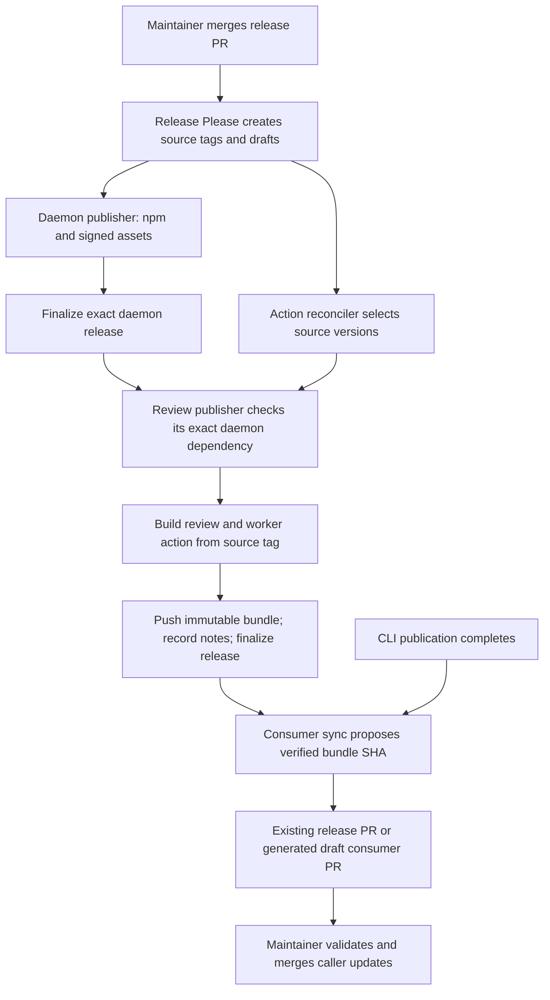

# Release and recover GitHub Actions

MoltNet publishes two actions from this repository: `agent-daemon-action` and
`adaptive-review-action`. Their executable JavaScript is built during release;
it is not committed on `main`. This guide explains how a source version becomes
a usable action, how consumer pins advance, and how to recover an interrupted
release without changing its identity.

## Release a daemon change for review consumers

Adaptive review ships its coordinator and worker action together. Its release
records the exact daemon version the workers download; callers adopt the
released bundle SHA rather than building from `main`. Publishing the daemon
alone does not update existing review callers.

1. Merge the implementation with the relevant runtime locks refreshed. Release
   Please's `node-workspace` plugin uses workspace dependencies to plan
   dependent releases. Adaptive review depends on both the daemon and its worker
   action, so inspect the generated release PR for those version changes.
2. Mark the draft release PR ready, let CI validate it, and merge it. The
   release workflow publishes the daemon package and signed platform assets,
   then finalizes the daemon release. The adaptive-review publisher waits for
   that job and checks the exact daemon version recorded in its source tag.
3. Inspect the published adaptive-review release's `Action bundle commit:` and
   `Review worker:` lines. If its daemon dependency is not published, recover
   the daemon first, then retry the action release as described below.
4. Review the consumer pin update. Synchronization updates an open Release
   Please PR when available; otherwise it reuses an open generated consumer PR
   or creates a draft `automation/published-consumer-pins-*` PR. Mark a new
   draft ready, let CI run, and merge it to activate the release in this
   repository. External repositories update their own caller SHA separately.

These are separate maintainer merge points: the release PR authorizes artifact
publication, and the consumer PR adopts an already published artifact. They can
share an existing release PR when one is open, but publication never writes new
consumer pins directly to `main` or automatically merges a PR.

## Inspect or retry a release

The **Release** workflow reconciles action publications on eligible pushes to
`main` and explicit legacy workflow dispatches. Pushes that only change
documentation or the other ignored paths in `release.yml` do not trigger it. An
ordinary run repairs incomplete latest action releases and the exact action
version required by the latest published daemon. It leaves older abandoned
drafts alone. There is no scheduled publication sweep: if a run fails and no new
eligible push occurs, rerun the failed jobs or dispatch recovery explicitly.

From a checkout containing the current release tooling, inspect the proposed
action jobs without publishing anything:

```bash
GH_TOKEN=$(gh auth token) node tools/release/action-release-state.mjs
```

The JSON lists the action source tags that require work. Empty output `[]` means
those candidates are complete; it says nothing about older releases. API or
integrity errors fail the command; they are not interpreted as missing releases.

To retry one exact action version, replace the example tag below with its
existing source release tag and dispatch the current workflow from `main`:

```bash
gh workflow run release.yml --ref main \
  -f engine=legacy -f action-tag=agent-daemon-action-v0.8.0
```

For an activated coding agent, follow the
[GitHub authorship guard](../integrations/github.md#authorship-guard) and wrap
GitHub writes with `moltnet github exec -- gh ...`.

The `dry-run` input controls **only the Nx engine**. A legacy dispatch publishes
artifacts. The exact `action-tag` input accepts only one of the two action
components and a stable `major.minor.patch` version.
`republish=agent-daemon-action` or `republish=adaptive-review-action` requests
the latest component version; use `action-tag` when recovering a particular
historical release. When `action-tag` is set, it replaces automatic action
candidate selection, even if `republish` is also set. The selected GitHub
release must already exist.

Use a new workflow dispatch after changing release tooling. Rerunning an old run
uses that run's workflow revision. Inspect the **Reconcile action releases**,
**Release @themoltnet/...**, and **Sync published consumer pins** jobs. Action
reconciliation runs independently of package resolution, so action metadata or
API failures do not block unrelated npm or Docker publication. List recent runs
and inspect the run you just dispatched:

```bash
gh run list --repo getlarge/themoltnet --workflow release.yml --limit 5
gh run view <run-id> --repo getlarge/themoltnet
```

After a successful publication, inspect the exact bundle ref and release notes:

```bash
ACTION_TAG=agent-daemon-action-v0.8.0
gh api "repos/getlarge/themoltnet/git/ref/tags/bundles/$ACTION_TAG" --jq .object.sha
gh release view "$ACTION_TAG" --repo getlarge/themoltnet --json isDraft,body,url
```

The ref's SHA must match the `Action bundle commit:` line in the notes, and
`isDraft` must be `false`. These checks complement the publisher's source and
bundle validation; a published GitHub release alone is not evidence of complete
publication. Consumer adoption is a separate checkpoint: inspect the release or
consumer PR and its pin changes, or the sync logs explaining why it kept the
existing pins.

## Publication contract

Three references have separate purposes:

| Reference                            | Meaning                                                           | Update policy              |
| ------------------------------------ | ----------------------------------------------------------------- | -------------------------- |
| `agent-daemon-action-v0.8.0`         | Original source commit on `main`; Release Please history boundary | Never move                 |
| `bundles/agent-daemon-action-v0.8.0` | Exact version's executable bundle commit                          | Create once; never replace |
| `v0`                                 | Most recently promoted daemon action in major zero                | Advance without downgrades |

Adaptive review uses the same source/bundle naming and the major alias
`adaptive-review-action-v0`. Additional SHA-suffixed `bundles/...` tags retain
historical bundle commits. Consumers execute full bundle SHAs. A source tag has
no compiled `dist/` and cannot be substituted for a bundle SHA.



[Download the diagram as a PNG](./assets/action-release-flow.png).

The daemon action also publishes independently for its other consumers. Adaptive
review includes the worker action's built files in its own bundle, so its worker
does not depend on a separately promoted daemon-action tag. Release Please uses
workspace dependencies to plan versions; the publisher enforces publication
order. Its gate requires the exact source daemon's published stable release and
nonempty, uploaded installer, Linux archive, checksum, and signature assets. It
checks asset metadata, not their downloaded contents or signatures.

The bundle includes `dist/worker-action/` and `dist/release-dependencies.json`.
The manifest records `daemonVersion` and `workerActionVersion` from the source
tree. All review jobs receive and verify the same bundle artifact digest;
workers restore the bundled action before launching it. The daemon executable is
still downloaded separately at the recorded version. Optional diary workers also
install exact daemon and pi-runtime npm versions; those dependencies are not
made self-contained by bundling the worker action.

Consumer sync waits for action publication, CLI wrapper publication (which
depends on platform packages), and daemon release finalization. Failed or
skipped producers do not suppress synchronization: it can adopt other eligible
publications while one release awaits recovery.

**Finalization is last**, as it is for npm, Docker and binary publications. A
tag may briefly point to a built bundle while its release is still a draft;
consumer synchronization requires both the published release and a verified
bundle. The workflow does not advertise a new release before its artifacts
exist.

The release controller (the scripts that validate and publish the bundle) comes
from the workflow revision, while application sources, lockfile and build
configuration come from the source tag. This allows a fixed controller to
recover historical releases. The publisher requires a clean tracked checkout
before creating the bundle commit; only `dist/` is added to that detached
commit.

Historical adaptive-review source tags retain their original required entries
and independently pinned worker contract. The reconciler derives the entry
requirements from the source manifest; retrying an old tag does not retrofit
bundled workers or the new daemon publication gate.

A retry reuses an existing exact bundle, even if a rebuild produces different
bytes. It can adopt the legacy major-tag bundle for the same version after
checking its source parent, package version, required entries and changed paths.
A different bundle for an existing version is an integrity error, not an update.
Publish a new version for changed behavior.

Major promotion uses a Git lease (an expected previous tag value) and an atomic
push with the immutable tags. That push also retains the previous major bundle
under a SHA-suffixed tag, keeping existing caller SHAs reachable after the alias
advances. A concurrent ref change rejects the push. Recovering an older version
retains its exact bundle without moving the major alias backward. Release
workflow runs are serialized, and action jobs run one at a time.

## Consumer updates and versioning

Consumer synchronization is a separate job after all pin producers finish. It
runs on the same legacy triggers, including an exact-version manual retry, and
can still run when discovery or publication fails. Cancelled runs do not
synchronize pins. It prefers an existing open Release Please PR, then an open
`automation/published-consumer-pins-*` PR. If neither exists and eligible pins
change, it creates a draft consumer PR from `main`. It creates no PR when there
is nothing to update. If a push succeeds but PR creation is interrupted, a retry
reuses that run's pushed branch and opens the missing draft without creating
another commit or release.

| Consumer family         | Candidate and eligibility                                                                       |
| ----------------------- | ----------------------------------------------------------------------------------------------- |
| CLI                     | npm's stable CLI version, available as wrapper and both Linux platform packages                 |
| Adaptive-review callers | Highest published stable adaptive-review action in major zero, with a verified immutable bundle |

Adaptive-review callers adopt the daemon version packaged with their review
release. They no longer receive separate daemon/action pin updates. A new
adaptive-review major requires a deliberate caller update.

Exact action lookup uses `bundles/<component>-v<version>`, independently of the
moving major alias. It validates the package version, source parent and required
files. Missing publication keeps the current pins and emits a warning; a present
but inconsistent mapping fails closed. Caller pins never move backward.

These edits reach consumers only after their PR merges. The job attempts each
family independently, refreshes runtime locks after all successful changes, and
pushes to an existing PR only if its head has not changed. One failed family
does not discard successful independent updates. The job reports those failures
after committing, so they remain visible. Release Please itself no longer fails
because a consumer candidate is unavailable.

`packages/adaptive-review-action/runtime.lock` tracks external files shipped
with that action. Changes to those files need a refreshed lock in a `fix` or
`feat` commit to trigger the component release. Refresh the lock again when
preparing a release PR after generated version changes; the consumer sync job
also refreshes locks before its commit. When that changes the adaptive-review
lock, the job uses `fix(adaptive-review-action): sync published runtime pins`
instead of a `chore(release)` commit. This makes the change eligible for an
action release even if Release Please has not selected that component in the
current PR; the version bump may arrive in the next release cycle. Keeping the
lock current does not mean the current PR already includes an action version
bump. CI checks every lock on the merged tree; publication checks only the
component being released. Never repair a historical source tag's unrelated lock
by rewriting the tag.

With the repository's Git hooks installed, each commit refreshes and stages
runtime locks after lint-staged formats the source files. The `--stage` mode
hashes the Git index, so unstaged source edits stay out of the lock. If a lock
needs refreshing and has unstaged edits of its own, the hook stops; stage or
stash those edits before retrying.

To refresh from staged content manually:

```bash
node tools/src/release/action-runtime-lock.ts --stage
```

For release preparation or environments without the hooks, `--write` hashes the
working-tree contents of indexed files. Stage new source files first, then
refresh and check the lock and include it in the commit:

```bash
node tools/src/release/action-runtime-lock.ts --write --project-root packages/adaptive-review-action
node tools/src/release/action-runtime-lock.ts --check --project-root packages/adaptive-review-action
```

Omit `--project-root` to refresh or check all component locks. Publication uses
`--check --project-root` for its selected component; CI checks all locks.

Renovate owns third-party action updates. MoltNet's consumer synchronizers own
this repository's action and reusable-workflow pins; release reconciliation owns
publication. Updating dependency references cannot repair a missing bundle
publication.

## Recovery checkpoints

| Interruption                                               | Next reconciliation                                                                      |
| ---------------------------------------------------------- | ---------------------------------------------------------------------------------------- |
| Before the tag push                                        | Rebuild from the same source and retry; no new release is finalized                      |
| Atomic push rejected                                       | Retry the exact version; remote bundle and alias changes were rejected together          |
| Bundle pushed, notes or finalization failed                | Reuse the same bundle, finish notes and publication                                      |
| Legacy release published without bundle                    | Create its exact bundle using the current controller, then complete publication metadata |
| Older release needs recovery after major advanced          | Retain the older exact bundle; preserve the newer alias                                  |
| API/authentication failure or inconsistent existing bundle | Fail visibly; correct the cause rather than overwrite an immutable ref                   |
| No open release PR                                         | Reuse or create a draft consumer PR; a maintainer still validates and merges it          |
| Review action awaits its exact daemon release              | Recover that daemon publication, then retry the same review action source tag            |

The reconciler considers the highest stable-semver release of each action,
including drafts, and the action required by the newest published daemon. It
paginates release discovery. It does not repair every historical release;
request those explicitly with `action-tag`.

Local tests use a temporary Git remote to exercise publication and failed
pushes, and simulated GitHub responses to exercise discovery and consumer
updates. They do not prove production token permissions. After deploying a
controller change, verify the actual publication job, remote exact bundle ref,
release notes, final published state, and resulting consumer PR before calling
the live recovery complete.
