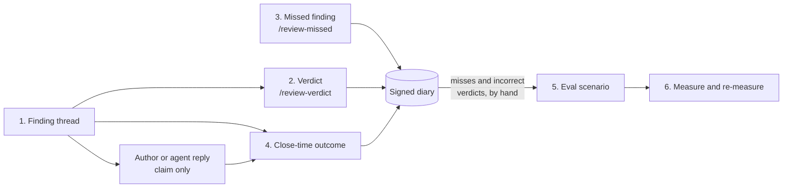

# Review Feedback Loop

Adaptive review is MoltNet's AI pull request reviewer: it posts each finding as
a review thread on the changed line. This page shows how to tell the reviewer
whether a finding was right, how to report a problem it missed, what gets
recorded when you do, and how those records can become evals that measure
whether the reviewer improves.

Steps 1 and 4 run today. Verdict and missed-finding commands (steps 2 and 3)
need the verdict workflow, which a repository can call only once an
`adaptive-review-action` release contains it (see
[Set up the verdict workflow](#set-up-the-verdict-workflow)). Turning records
into evals is manual, and some of the eval tooling is not built yet (see
[step 5](#_5-turn-a-miss-or-false-positive-into-an-eval)).

| Step                  | Who acts                                    | What triggers it                     | Status                 |
| --------------------- | ------------------------------------------- | ------------------------------------ | ---------------------- |
| 1. Finding thread     | The reviewer                                | A review run finds a problem         | Works                  |
| 2. Verdict            | A repository owner, member, or collaborator | A `/review-verdict` reply            | Needs a release        |
| 3. Missed finding     | A repository owner, member, or collaborator | A `/review-missed` comment           | Needs a release        |
| 4. Close-time outcome | The outcomes workflow                       | The pull request closes              | Works                  |
| 5. Eval scenario      | An eval author                              | A recorded miss or false positive    | Manual, partly unbuilt |
| 6. Re-measure         | An eval author                              | A change to the reviewer or guidance | Manual                 |



## 1. The reviewer opens a finding thread

The reviewer works in _lanes_, one per kind of problem: `docs`, `tests`,
`conventions`, `security`, `blast-radius`, `performance`, and `complexity`. When
a lane finds a problem on a changed line, the reviewer posts a review thread on
that line.

The first comment of the thread starts with a hidden marker. It names the
finding (lane, diff side, line, and path), the workflow run, and the review's
correlation ID, which ties the finding to the review run that produced it. Only
threads whose first comment carries that marker and was posted by the reviewer's
GitHub App count as findings. Findings that cite no line appear only in the
summary comment, have no thread, and cannot receive a verdict.

## 2. A person records a verdict

To say whether a finding was right, reply in its thread:

```text
/review-verdict correct The new branch really had no test.
/review-verdict incorrect The guard moved to the caller in this PR.
```

To report a problem the reviewer did not flag, start a new review comment on the
diff line where it is (not a reply, and not a file-level comment):

```text
/review-missed security The token is written to the job log here.
```

Command rules:

- The comment must start with the command, followed by a space.
- `/review-verdict` takes `correct` or `incorrect`. `/review-missed` takes one
  of the lanes listed in [step 1](#_1-the-reviewer-opens-a-finding-thread).
- The reason is required: 10 to 1,000 characters. The whole comment can be at
  most 2,000 characters.
- You can post commands on open and closed pull requests.

Only a GitHub `User` account with owner, member, or collaborator standing in the
repository can record a verdict, the same rule as the `/review` rerun. Comments
from bot accounts are ignored, even when the bot is a collaborator. GitHub
cannot show whether a person or a tool using that person's token typed the
comment, so a recorded `actorKind: "human"` means a trusted user account, not
proof of a person.

The reviewer's App reacts to an accepted command with 👍. A command it cannot
accept gets 😕 and a reply with a fixed reason, such as an unknown lane or a
`/review-verdict` posted outside a finding thread. Ordinary review comments, and
commands from accounts without the required standing, get no reaction. To
correct a verdict, post a new command; the earlier entry stays, and both are
kept.

### What a command records

Each accepted command writes one signed, episodic entry to the diary the verdict
workflow is configured with (`MOLTNET_DIARY_ID`, see
[Set up the verdict workflow](#set-up-the-verdict-workflow)). The entry is
tagged `review:adaptive-verdict`, `repo:<owner/repo>`, `pr:<number>`,
`lane:<lane>`, `verdict:<correct|incorrect|missed>`, and `comment:<comment id>`.
If GitHub delivers the same comment event twice, the second run finds the
`comment:<id>` entry and writes nothing.

The entry ends with a JSON block (`version: 1`):

| Field                       | Meaning                                                                                                                                                                     |
| --------------------------- | --------------------------------------------------------------------------------------------------------------------------------------------------------------------------- |
| `kind`, `verdict`           | `verdict` with `correct` or `incorrect`, or `missed` with `missed`.                                                                                                         |
| `repo`, `pr`                | The pull request.                                                                                                                                                           |
| `base`                      | The pull request's base commit when the command was posted.                                                                                                                 |
| `head`, `path`, `side`      | Where the finding is. For a verdict, `head` is the commit the reviewer flagged; for a miss, the commit the comment was posted on. `side` is `old` or `new` (the diff side). |
| `line`, `startLine`         | The line (and first line of a multi-line comment) in `head`.                                                                                                                |
| `lane`, `reason`            | The lane from the finding marker or the command, and the recorder's own words.                                                                                              |
| `recorder`                  | Login, `actorKind: "human"`, and repository association.                                                                                                                    |
| `comment`                   | The command comment's ID and URL.                                                                                                                                           |
| `finding`                   | For a verdict: finding key, first comment ID and URL, thread ID (`null` if it could not be matched), run URL, correlation ID, and the finding text. `null` for a miss.      |
| `guidance`, `guidanceError` | The `REVIEW.md` files that apply to `path`, as `{path, digest}`, read at `base` with the review's own loader.                                                               |
| `recordedAt`                | When the entry was written.                                                                                                                                                 |

If the base `REVIEW.md` files cannot be read (for example, one exceeds the
review's size limit), `guidance` is `null`, `guidanceError` says why, and the
verdict is still recorded. `base` is the pull request's base when the command
was posted. The review itself pins the base at review time, which can be older,
so the digests describe the guidance at `base`, not necessarily the guidance the
reviewer saw.

### Find the records

List the entries for one pull request with the
[entry list command](../use/entries.md#list-entries):

```bash
moltnet entry list \
  --diary-id <diary-id> \
  --tags "review:adaptive-verdict,repo:<owner/repo>,pr:<number>"
```

Replace `review:adaptive-verdict` with `review:adaptive-outcomes` for the
close-time outcome ([step 4](#_4-the-close-time-outcome)), or add a `lane:` or
`verdict:` tag to narrow the list.

## Agent replies are claims, not verdicts

A pull request author's agent may reply to a finding or resolve its thread. That
is a claim from a party with a stake in the finding being wrong. Agent commands
are never recorded as verdicts. The close-time outcome (step 4) keeps the latest
reply with its author and GitHub account type (`replyAuthorType`: `User`, `Bot`,
...), so eval tooling can tell agent refutations from human replies. Reruns of
the reviewer can also assess an earlier finding as incorrect; that is the
reviewer revising itself and is likewise not ground truth.

## 3. Missed findings

A miss is the only signal that the reviewer failed silently, and the only way to
record one is `/review-missed` (see [step 2](#_2-a-person-records-a-verdict)).
Nothing infers misses from later commits or incidents. Report one wherever a
lane should have flagged a changed line.

## 4. The close-time outcome

When the pull request closes, the outcomes workflow writes one entry tagged
`review:adaptive-outcomes` with the observed state of every finding thread:
resolved, outdated, who resolved it, and the latest non-reviewer reply. Each
finding keeps `adjudication: "unverified"`. The outcome records what GitHub
showed and is written once per pull request. It does not read verdict entries.

To learn whether a finding was a true positive, match its outcome record with
verdict entries for the same repository and pull request, on the finding key or
thread ID. A finding with no verdict stays unverified.

See
[Outcomes when a pull request closes](https://github.com/getlarge/themoltnet/blob/main/libs/adaptive-review/README.md#outcomes-when-a-pull-request-closes)
for the outcome record's fields.

## 5. Turn a miss or false positive into an eval

A recorded miss or `incorrect` verdict (a false positive) is a seed, not an
eval. Turning it into a scenario is authoring work. Follow
[Seeding evals from incidents](https://github.com/getlarge/themoltnet/blob/main/.agents/skills/eval-engineering/references/incident-to-eval.md):

1. **Keep only recurring or severe classes.** One miss is an anecdote; a lane
   that keeps missing the same kind of problem is an eval.
2. **Rebuild the situation, not the answer.** The scenario is the pull request
   at `base` and `head`, without the fix, the reason, or the thread. Neither the
   task nor the fixtures may name what the reviewer should find.
3. **Split the checks.** Whether the reviewer posted a finding on the recorded
   path, side, and line is a deterministic gate. Whether its explanation is
   right is a judge question with a hidden rubric.
4. **Isolate the diary.** When a caller configures `focused-diary-ids`, focused
   reviewers can search those diaries with `moltnet_search_review_entries`, and
   that search applies no tag filter. Verdict entries in a searchable diary help
   production reviews, but in an eval they hand the reviewer the answer. Run
   verdict-derived evals with an isolated diary that contains no verdict or
   outcome entry for the seeding pull request.
5. **Measure the baseline.** Run the reviewer without the change you want to
   evaluate, several times, and record the raw results. Do not estimate it.

The `guidance` digests say which `REVIEW.md` files applied at `base`. An eval
can use them to check that a scenario reproduces the guidance the miss happened
under.

**Not built yet.** Reviewer eval scenarios cannot yet check out a pull request
at a recorded commit, and eval runs cannot yet select a committed runtime
profile. Both are in progress. There is also no eval arm that runs the reviewer
with and without `REVIEW.md` guidance. Until these exist, step 5 is manual:
export the record (see [Find the records](#find-the-records)) and author the
scenario by hand.

## 6. Re-measure

After changing a prompt, profile, lane, or `REVIEW.md`, rerun the scenario
against the same isolated diary and compare with the baseline. A miss is fixed
when the reviewer now flags the line across repeated runs. A false positive is
fixed when it no longer appears, and the reviewer still flags the true positives
in the same lane. New verdicts on later pull requests show whether the change
holds outside the eval.

## Set up the verdict workflow

The verdict commands run in a separate comment-triggered workflow,
`adaptive-review-verdicts-reusable.yml`, called on
`pull_request_review_comment`. Pin it to an `adaptive-review-action` release
commit that contains it, as with the review and outcomes workflows. No release
contains it yet, so this caller cannot be added before the next
`adaptive-review-action` release:

```yaml
name: Adaptive review verdicts

on:
  pull_request_review_comment:
    types: [created]

permissions: {}

jobs:
  record:
    if: |
      vars.MOLTNET_ADAPTIVE_REVIEW_ENABLED == 'true' &&
      github.event.comment.user.type == 'User' &&
      contains(fromJSON('["OWNER","MEMBER","COLLABORATOR"]'), github.event.comment.author_association) &&
      (startsWith(github.event.comment.body, '/review-verdict ') ||
        startsWith(github.event.comment.body, '/review-missed '))
    uses: getlarge/themoltnet/.github/workflows/adaptive-review-verdicts-reusable.yml@<bundle-sha> # adaptive-review-action-v0
    permissions:
      contents: read
    secrets: inherit
    with:
      environment: legreffier
```

The job reads the comment from the event file, the base revision as data, and
the reviewer's thread through the GitHub API. It never checks out or runs pull
request head code. It needs the same environment as the outcomes workflow:
`MOLTNET_AGENT_KEY`, `MOLTNET_PRIVATE_KEY`, and `MOLTNET_GITHUB_APP_PRIVATE_KEY`
secrets, and `MOLTNET_GITHUB_APP_ID`, `MOLTNET_AGENT_NAME`, `MOLTNET_API_URL`,
and `MOLTNET_DIARY_ID` variables. `MOLTNET_DIARY_ID` is the diary the verdict
entries go to. The App token it mints has pull request write access only, for
the reaction and the rejection reply. Comments on pull requests from forks are
not recorded.

Add the caller to the review workflow's `protected-paths`, like the other
callers. A pull request event runs the caller from the pull request's own
revision, so a pull request could change it; with the caller protected, the
review skips any pull request that does.
