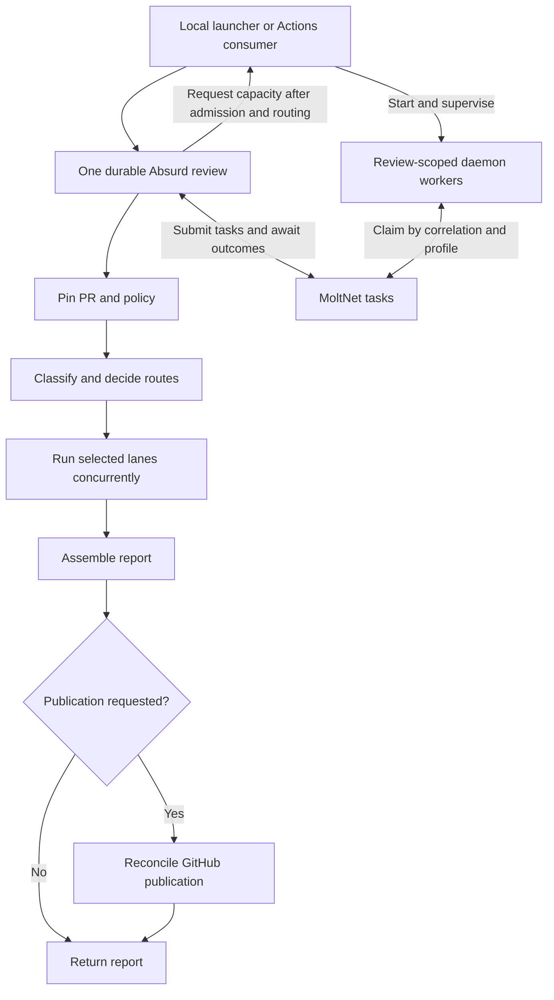

# Run and resume an adaptive review

Adaptive review runs as one Absurd task: it pins a pull request, classifies
its changes, selects review lanes, waits for MoltNet tasks, assembles a report,
and optionally publishes it. The same Node entry point runs locally and in
GitHub Actions. Actions supplies infrastructure and credentials; it does not
choose or sequence review stages.

## Run the complete workflow

For a headless smoke test of merged source, dispatch the repository's
`Adaptive review source smoke` workflow on `main`:

```bash
gh workflow run adaptive-review-smoke.yml --ref main -f pr=123 -f mode=shadow
```

It builds the host and runs workspace workers from the dispatch's exact `main`
revision, with real model providers and MoltNet tasks. The reviewed PR remains
data. This path needs no runtime release or consumer pin update. It uses the
existing `legreffier` environment and live profiles, a read-only GitHub token,
and report-only publication. Lane statuses appear in the run summary; findings
stay on the ephemeral runner. A skipped review fails the smoke because it did
not exercise the complete workflow. Its disposable Absurd database cannot resume
a lost job; dispatch again for a new execution.

For a local run, use the following setup.

Use a trusted MoltNet runtime checkout, the Node version in `.tool-versions`,
pnpm, Git, and `gh`. Build the runtime outside the reviewed head:

```bash
pnpm install --frozen-lockfile
pnpm exec nx run @themoltnet/adaptive-review-action:build
export REVIEW_DIST="$PWD/packages/adaptive-review-action/dist"
export ADAPTIVE_RUNTIME_SHA="$(git rev-parse HEAD)"
```

The bundle is currently a private workspace artifact, not an npm-installed
review CLI. Keep `review-worker.js`, its shared chunks, and the worker manifest with `run.js`.

Provide an initialized Absurd 0.4.0 database through `ADAPTIVE_DATABASE_URL`,
MoltNet credentials with `task:write` plus the daemon credential scopes,
`MOLTNET_TEAM_ID`, `MOLTNET_DIARY_ID`, and the profiles
required by the base policy. `ADAPTIVE_CLASSIFIER_PROFILE` is always required;
set `ADAPTIVE_FOCUSED_PROFILE`, `ADAPTIVE_DOCS_PROFILE`,
`ADAPTIVE_COMPLEXITY_PROFILE`, and `ADAPTIVE_SECURITY_PROFILE` for their enabled
lanes. The existing [environment contract](#environment-contract)
lists the profile and budget variables. Set `ADAPTIVE_APP_LOGIN` to the reviewer
App login, including `[bot]`. Supply its repository-scoped token as `GH_TOKEN`.
For automatic token renewal during long reviews, instead supply
`ADAPTIVE_GITHUB_APP_ID` and `MOLTNET_GITHUB_APP_PRIVATE_KEY`; tokens are scoped
to the reviewed repository and refreshed in memory.

For locally managed workers, install the compatible released `moltnet-agent`,
set `MOLTNET_AGENT_NAME`, and configure its model providers and signing
credentials using the [daemon guide](../../apps/agent-daemon/README.md).
Use the exact daemon version recorded in `dist/release-dependencies.json`.
`MOLTNET_DAEMON_BIN` can select an installed binary or trusted wrapper; the
launcher does not check that binary's version.

Change to a checkout of the repository being reviewed, then run:

```bash
node "$REVIEW_DIST/run.js" \
  --repo owner/repository --pr 123 \
  --execution-id '<new-review-uuid>' \
  --report /absolute/private/review-report.json
```

The default creates a report without publishing to GitHub. Report-only still
creates and runs MoltNet review tasks. Add `--publish` (or set `ADAPTIVE_PUBLICATION=github`) to
include publication in the workflow. Use `--help` for options. The workflow
still uses GitHub to read PR metadata and previous findings. It checks eligibility
before fetching pinned Git objects or submitting model tasks, and reads policy
and review guidance from the pinned base. It never executes the reviewed head
to run the review.

The local launcher starts capacity as each phase needs it. Classification
requests one classifier worker. After routing, the workflow requests only the
selected specialist pools: up to four focused workers, one for each other routed
pool, and both headless and Git worktree strategies for project-scoped docs.
Every worker filters claims by review correlation ID, team, profile and task type.
Task creation checks correlation, team and diary, including semantic repairs.
Unprojected reviews explicitly select General.

Capacity belongs to the current host, not durable workflow state. Resuming an
incomplete phase requests capacity again. Each daemon runs behind a guardian
process. Host loss disconnects the guardian, which terminates the daemon process
group and escalates to SIGKILL after ten seconds if descendants remain. Normal
shutdown signals workers before waiting for the coordinator to drain. Structured
logs retain their JSON format and include the pool, worker index and process IDs.

Workers stop when the review finishes, the host fails, receives SIGINT/SIGTERM,
or reaches its timeout. An unexpected worker exit fails the host. Restart with
the same execution ID to supply replacement capacity. Shutdown can leave an
active single-attempt child task terminal. Neither replay nor
`ADAPTIVE_RETRY_FAILED=true` creates replacements for terminal child tasks.

With `--workers external`, the launcher does not start workers. The operator
provides matching profiles, task types, team, correlation filters and project
bindings, plus their credentials, sandbox configuration and lifecycle management.
Correlation filters select work; authorization and sandbox policy enforce isolation.
Both modes run the same Absurd workflow.



## Resume the complete workflow

Reuse the execution UUID, original options, runtime, database, and team/profile
configuration. The UUID is also the correlation ID on every child task. A new
intentional review needs a new UUID; a replacement host keeps the old one.
The workflow has its own versioned queue namespace, separate from legacy stage
executions. Immutable input binding rejects changing options on resume.

Completed checkpoints retain classifier decisions, task IDs, lane results and
publication state. Replacement hosts reconstruct local Git objects for unfinished
investigation; publication reuses the saved report. No prepared or routing JSON
files are required. Recoverable task-API interruptions, including wrapped parallel creation
failures, escape lane checkpoints so the coordinator can recover. Deterministic
task-API rejections are recorded as lane failures; terminal task outcomes retain
the daemon's existing attempt classification. Daemon attempt policy, bounded semantic repair,
and explicit terminal-task recovery remain distinct. Existing review tasks
retain their configured one-attempt limit; this change does not increase it.

A failed workflow that exhausted automatic attempts requires explicit
`ADAPTIVE_RETRY_FAILED=true` with the original command. This reuses completed
checkpoints; it does not recreate terminal child tasks or clear failed lane
results. A lane failure is written to the report and makes the command exit 1.
Inspect coverage: successful process exit is not review clearance.

A persistent database allows recovery after loss of the host. A disposable
local or CI database only permits recovery while that database survives.
The launcher does not provision or initialize a local database. For a fresh
database you own:

```bash
ABSURD_DATABASE_URL="$ADAPTIVE_DATABASE_URL" uvx absurdctl init --ref 0.4.0
```

## Environment contract

Command-line options override their corresponding environment settings.

| Setting                                                                                                         | Complete-workflow use                                                                                              |
| --------------------------------------------------------------------------------------------------------------- | ------------------------------------------------------------------------------------------------------------------ |
| `ADAPTIVE_DATABASE_URL`                                                                                         | Required initialized Absurd database; keep it on resume.                                                           |
| `ADAPTIVE_EXECUTION_ID`                                                                                         | Alternative to `--execution-id`; stable review UUID.                                                               |
| `ADAPTIVE_REPOSITORY`, `ADAPTIVE_PR`                                                                            | Alternatives to `--repo` and `--pr`.                                                                               |
| `MOLTNET_TEAM_ID`, `MOLTNET_DIARY_ID`                                                                           | Required task scope; optional `MOLTNET_PROJECT_ID` selects project scope.                                          |
| `ADAPTIVE_RUNTIME_SHA`                                                                                          | Required full runtime commit SHA; a label, not code attestation.                                                   |
| `ADAPTIVE_MODE`                                                                                                 | `active` (default) or `shadow`.                                                                                    |
| `ADAPTIVE_CLASSIFIER_PROFILE`                                                                                   | Required profile ID or name in the selected team.                                                                  |
| `ADAPTIVE_FOCUSED_PROFILE`, `ADAPTIVE_DOCS_PROFILE`, `ADAPTIVE_COMPLEXITY_PROFILE`, `ADAPTIVE_SECURITY_PROFILE` | Required for their enabled policy lanes.                                                                           |
| `ADAPTIVE_TASK_BUDGETS`                                                                                         | Optional YAML/JSON budget overrides; validated before dispatch.                                                    |
| `PROTECTED_PATHS`                                                                                               | Optional newline-separated paths excluded from review eligibility.                                                 |
| `ADAPTIVE_APP_LOGIN`                                                                                            | Required reviewer App login, including `[bot]`.                                                                    |
| `GH_TOKEN`                                                                                                      | Repository token for GitHub reads and, when requested, publication.                                                |
| `ADAPTIVE_GITHUB_APP_ID`, `MOLTNET_GITHUB_APP_PRIVATE_KEY`                                                      | Alternative renewable App authentication, scoped to the repository and requested publication mode; held in memory. |
| `ADAPTIVE_PUBLICATION=github`                                                                                   | Equivalent to opting into publication with `--publish`.                                                            |
| `ADAPTIVE_REPORT`                                                                                               | Alternative to `--report`; JSON report destination.                                                                |
| `ADAPTIVE_RUN_URL`                                                                                              | Stable source link for publication; defaults to the PR URL.                                                        |
| `ADAPTIVE_INLINE_FINDINGS=false`                                                                                | Disable inline finding threads.                                                                                    |
| `GITHUB_API_URL`, `GITHUB_GRAPHQL_URL`, `GITHUB_SERVER_URL`                                                     | Optional GitHub endpoint overrides; configure `gh` for that host too.                                              |
| `MOLTNET_DAEMON_BIN`                                                                                            | Trusted local daemon executable or wrapper; never PR-supplied configuration.                                       |
| `ADAPTIVE_TIMEOUT_SEC`                                                                                          | Host timeout in seconds, overridden by `--timeout-sec`.                                                            |
| `ADAPTIVE_RETRY_FAILED=true`                                                                                    | Retry an exhausted coordinator while preserving its saved checkpoints.                                             |

MoltNet credential and provider setup follows the
[daemon guide](../../apps/agent-daemon/README.md). Workers do not inherit GitHub
publication credentials or coordinator database URLs. Git and `gh` subprocesses
receive runner basics and the scoped token, rather than model or identity secrets.

## Host lifetime and identity

`--execution-id` supplies the review UUID and the child-task correlation ID.
Absurd assigns its own internal workflow task ID. Durable Actions reruns retain
the review UUID; ephemeral reruns include the run attempt in its derivation.
Actions derives the review UUID with the launcher’s correlation helper.

Connections and Git preparation are reused within one host. PR/profile currency
checks may be cached for 30 seconds while unfinished phases replay. Replacement
hosts reconstruct preparation and validate pinned revisions afresh. Keep runtime
profiles stable while tasks remain outstanding: claims select the current profile
by ID, not an independently stored historical model configuration.

The local host timeout defaults to two hours. Actions recomputes the remaining
budget after provider setup, within the 125-minute job budget and with two minutes
reserved for cleanup. That also caps an explicit timeout. Local and external
worker modes share the same timeout/cancellation signal. Workflow failures report
the review ID and sanitized underlying details; host logs distinguish start and resume.

## Choose an execution mode

`execution-mode` controls how long coordinator checkpoints survive.
It is separate from `mode: active` or `mode: shadow`, which controls which
review lanes run.

| Choice              | Database owner                                                                                             | Recovery boundary                                                                                     |
| ------------------- | ---------------------------------------------------------------------------------------------------------- | ----------------------------------------------------------------------------------------------------- |
| `durable` (default) | You provide an initialized persistent database through the `ADAPTIVE_DATABASE_URL` secret.                 | Replacement jobs resume the same review while its database state and pinned inputs remain available.  |
| `ephemeral`         | Actions starts and initializes disposable Postgres for each coordinator job. No database secret is needed. | Checkpoints last only for that job. Re-running all jobs starts a new review and can submit new tasks. |

Both choices run the same complete Absurd workflow. Ephemeral mode does not
select an in-memory engine or fall back when a durable database is unavailable.
The exported library functions can use an inline `WorkflowContext` for embedding
and unit tests; the launcher always uses Absurd.

### Launch through GitHub Actions

Add a caller workflow in the repository being reviewed. This example assumes
its base branch has a [review policy](README.md) enabling only `tests`, and
that you have provisioned classifier and focused review profiles. Replace
`<release-commit-sha>` with the full action bundle commit SHA from a release
containing this implementation; the placeholder is not an executable pin.

```yaml
name: Adaptive review
on:
  pull_request:
    types: [opened, ready_for_review, synchronize, reopened]
permissions: {}
jobs:
  review:
    if: github.event.pull_request.draft == false
    uses: getlarge/themoltnet/.github/workflows/adaptive-review-reusable.yml@<release-commit-sha> # adaptive-review-action-v0
    permissions:
      actions: read
      contents: read
      pull-requests: write
    secrets: inherit
    with:
      environment: review
      execution-mode: durable
      runtime-ref: <release-commit-sha>
      mode: active
      api-url: https://api.themolt.net
      team-id: <team-uuid>
      diary-id: <diary-uuid>
      agent-name: <agent-name>
      app-id: <github-app-client-id>
      classifier-profile: <classifier-profile-name-or-id>
      focused-profile: <focused-profile-name-or-id>
      providers: id=ollama-cloud base-url=https://ollama.com/v1 key-env=OLLAMA_API_KEY supports-developer-role=false
      protected-paths: |
        .github/workflows/adaptive-review.yml
```

Use your caller's actual filename in `protected-paths`. Set `runtime-ref` to the same bundle SHA as the reusable workflow pin.
For this repository, the post-publication `sync-consumer-pins` release job updates
both caller pins together in the release PR or a generated consumer-adoption PR.
The generated PR still requires validation and merge; no manual SHA editing is
needed. External repositories must arrange their own adoption automation.
This explicit pin also works when the runner omits workflow identity context. Obtain the full bundle SHA
from that release's `Action bundle commit:` line; the source tag has no compiled
bundle. The [action release guide](../../docs/contribute/action-releases.md)
explains publication and adoption.

Releases containing the bundled worker action record its daemon version in
`dist/release-dependencies.json`. Leave `daemon-version` unset to use that exact
version. An explicit override must be an exact stable `major.minor.patch`
version; prerelease suffixes are rejected. The caller owns compatibility with
its selected review bundle. Released bundles
skip workspace installation and compilation. The consumer restores its worker action from the same pinned review bundle.
Optional diary context still installs its exact external runtime dependencies.
A deliberate `runtime-ref` override must be a full trusted commit SHA; a source
checkout without the bundle installs and builds it during preparation.

Supply profiles for any additional enabled lanes and providers matching those
profiles. The
[runtime policy guide](../../.github/runtime-policies/README.md) covers profiles
and optional diary access.

Configure the selected environment with `MOLTNET_AGENT_KEY`,
`MOLTNET_PRIVATE_KEY`, `MOLTNET_GITHUB_APP_PRIVATE_KEY`, and the provider secret
(`OLLAMA_API_KEY` in this example). The App must be installed on the repository
and allow pull request writes. In durable mode, also set
`ADAPTIVE_DATABASE_URL` to an initialized database reachable by the hosted
runners. The workflow checks that the URL is present; it does not create,
initialize, or migrate that database.

For disposable execution, change only this input and omit the database secret:

```yaml
with:
  execution-mode: ephemeral
  # Keep the remaining inputs from the caller above.
```

Actions creates one Postgres service for the complete review job. The [setup helper](../../tools/setup-adaptive-review-database.sh)
initializes each disposable service with Absurd schema `0.4.0`. Classification, selected lanes and publication use the same workflow state.
There are no prepared/routing artifact handoffs. Losing the disposable database
loses coordinator checkpoints; an ephemeral Actions rerun starts a new review.
The helper never initializes a supplied durable URL.

The Actions job starts the standalone host and worker capacity for the configured
classifier and specialist profiles. Absurd selects the lanes and retains their
results; no separate coordinator service is needed. A new authorized `/review` request
starts a new Actions run. See the [caller guidance](README.md#findings-and-outcomes)
for adding the comment trigger and its authorization checks.

## Removed stage interface

Complete reviews use `run.js`; this release no longer ships `review.js`,
`publish.js`, `ADAPTIVE_STAGE`, prepared/route handoff files, or worker matrices.
The composite action supports only `outcomes` and `cleanup`. Existing release
pins keep their own code. Resume unfinished stage-based reviews with their
original pinned release; use a new execution ID for the complete workflow.

## Retention and cleanup

Durable recovery lasts until the execution's coordinator data is cleaned up.
By default, an execution becomes eligible after **30 days without coordinator
use after the complete workflow returned successfully**, or **90 days otherwise**.
Successful completion includes report-only and skipped reviews. Failed or interrupted
coordinators use the 90-day window. The stored `published` column retains its
historical name; it now marks terminal workflow completion.
Each workflow host refreshes the last-use time on entry and exit. A crash or lost
connection can prevent the exit update; retention then uses the last
successfully recorded activity. A live, connected coordinator holds a database
session lock, so cleanup skips it even if its last-use time is old. A MoltNet
daemon running on its own does not hold that lock.

Every workflow invocation initializes retention, locks its execution identity,
checks that it has not expired, and refreshes its last-use time. Before executing
review work it applies an oldest-first cleanup batch of at most 25 eligible
executions. This protects the review being resumed from its own sweep.
The deadline makes an execution eligible; it does not schedule deletion at an
exact time. If the database is idle, use an operator-managed daily scheduler
to run the cleanup command below. Increase the retention windows before their
deadlines if you need a longer recovery period.

Using the trusted runtime bundle built [above](#run-the-complete-workflow),
preview a batch, then apply it:

```bash
: "${ADAPTIVE_DATABASE_URL:?set the coordinator database URL}"
: "${REVIEW_DIST:?set the trusted action bundle directory}"
ADAPTIVE_CLEANUP_APPLY=false \
  node "$REVIEW_DIST/run.js" --cleanup
ADAPTIVE_CLEANUP_APPLY=true \
  node "$REVIEW_DIST/run.js" --cleanup
```

Cleanup defaults to a dry run when `ADAPTIVE_CLEANUP_APPLY` is unset. It needs
database access, but no PR checkout, handoff files, GitHub token, MoltNet
credentials, or daemon workers. It prints a JSON array with the hashed queue
name and outcome: `would-expire` in a preview, `expired` after deletion,
`active` when a lock prevents cleanup, or `retained` if a concurrent resume
refreshed the execution. Each command considers at most 25 candidates; repeat
for a backlog, and retry active executions on a later scheduled run. An empty
array means no registered execution is currently eligible.

The database stores one retention policy in
`public.adaptive_review_retention_policy`. The first workflow host initializes it;
on a fresh database, the first workflow invocation can set custom values. A database with
an existing retention registry but no policy record adopts the documented
30/90-day defaults. Run a workflow with those defaults before trying cleanup on
such a database. Cleanup does not initialize or change the policy.

Configure the workflow and scheduled cleanup to match the stored policy:

```bash
export ADAPTIVE_RETENTION_COMPLETED_DAYS=30
export ADAPTIVE_RETENTION_UNFINISHED_DAYS=90
```

Both accept whole numbers from 1 to 36500. Reusable-workflow callers set the
equivalent `with` inputs:

```yaml
with:
  retention-completed-days: 30
  retention-unfinished-days: 90
  # Keep the remaining inputs from your caller.
```

For a scheduled Actions job, the composite action also accepts `step: cleanup`
with the same database, retention, and apply environment variables. Pin a
release containing this implementation, as described
[above](#launch-through-github-actions); no daily cleanup workflow is installed
automatically. All callers and schedulers sharing a database must match its
policy: a sweep covers every registered execution in that database, not just
the calling repository. Workflow startup and cleanup fail closed on a mismatch.
Once the database policy is initialized, changing environment variables or
workflow inputs cannot change it.

To change an initialized policy, the database owner must coordinate the new
values across all callers and cleanup schedulers. Pause new workflows and
scheduled cleanup during the change, update their configuration, then use the
following transaction to inspect the current values and set a 60/180-day policy:

```bash
psql "$ADAPTIVE_DATABASE_URL" --set=ON_ERROR_STOP=1 <<'SQL'
BEGIN;
SELECT completed_days, unfinished_days
FROM public.adaptive_review_retention_policy
WHERE singleton
FOR UPDATE;

UPDATE public.adaptive_review_retention_policy
SET completed_days = 60, unfinished_days = 180
WHERE singleton;

SELECT completed_days, unfinished_days
FROM public.adaptive_review_retention_policy
WHERE singleton;
COMMIT;
SQL
```

Set the assignments to `30` and `90` to restore the defaults. Confirm the result
contains the single policy row and the expected values, then resume callers and
preview cleanup. Cleanup holds a shared lock on that row for each deletion
transaction, so the update waits for any deletion already in progress. Lowering
either window can immediately make existing executions eligible for deletion
on the next sweep; it does not restore data already removed under an older policy.

Cleanup atomically drops the execution queue and its `-input` companion,
including their tasks, checkpoints, bound inputs, and stored results. It retains
a small **tombstone** in `public.adaptive_review_retention` indefinitely: the
hashed queue name, last-use and expiry timestamps, and publication flag, without
review content. A later attempt to use that execution ID fails with an expiry
error; start a new review with a new ID and new state files. Do not purge these
tombstones while old execution IDs can still be retried.

Use a direct Postgres connection or a session pool for `ADAPTIVE_DATABASE_URL`.
The shared advisory session lock and Absurd queries use the same `pg.Client`
connection; PgBouncer transaction or statement pooling cannot preserve that
session-lock contract and is unsupported.

Stage hosts create the retention and policy tables and the retention index on
first use; their database role must be able to create and update them, and
cleanup must be able to drop the Absurd queues. Cleanup only touches registered
executions. Older queues
that have never run under this implementation remain untouched until a stage
registers them. Do not run independent Absurd task cleanup on these execution
queues: removing individual records breaks the recovery and input-binding
contract before the execution expires.

This policy covers coordinator Postgres data only. It does not delete MoltNet
tasks, GitHub reports, local JSON files, or Actions artifacts. Ephemeral databases
still disappear with their host job regardless of these windows.

## Publication recovery

Publication binds the report, expected identity, run URL, App login, and inline
setting. It checks the current PR revisions before writes and again afterward.
On replay, it reads existing App-owned summary comments and review threads.
Location keys prevent repeating existing findings; resolved findings remain
in the summary. Execution markers identify this run's output for stale cleanup.

If GitHub accepted a write before the process lost its response, resuming the complete workflow with the same execution ID reconciles that external state. If the PR is now stale, recovery
removes this execution's marked inline comments and replaces its own summary
with a stale notice, then fails. Inline deletion requires an App-owned comment
whose parsed marker matches the correlation ID and both pinned base and head
revisions. Legacy markers remain readable for finding deduplication, but stale
recovery deliberately leaves comments without both revisions in place. It does
not overwrite a newer execution's marked summary during stale recovery. GitHub
rejecting inline anchors with HTTP 422 falls back to summary-only findings.

This is reconciliation, not a transaction spanning GitHub and Postgres. The
implementation does not promise exactly-once GitHub writes under arbitrary
concurrent publishers or visibility delays. Once publication has completed in
Absurd, replay returns its stored result; it does not continuously monitor the
PR or withdraw findings after every future push. The reusable Actions consumer serializes reviews per PR; other launchers must
coordinate independent reviews for the same PR.

## Verification

Absurd persists state; a launcher supplies the Node process and worker capacity.
No database-only service continues a review after every host and worker exits.
The reusable Actions consumer authorizes events and provisions the trusted runtime;
other callers own launch authorization and credentials.

The [recovery unit tests](__tests__/recovery.spec.ts) simulate checkpoint replay,
creation crash gaps and bounded repairs. The real-Postgres
[integration suites](__tests__/recovery.integration.spec.ts) kill and replace
coordinators, verify stable child IDs, reject changed inputs, and exercise explicit
failed-workflow retry. The [whole-review suite](__tests__/standalone.integration.spec.ts)
checks routing recovery and completed replay. The [retention suite](__tests__/retention.integration.spec.ts)
covers both cutoffs, locks, expiry, atomic deletion and credential-free cleanup.

Run them against an initialized test database:

```bash
NX_LOAD_DOT_ENV_FILES=false \
ADAPTIVE_TEST_DATABASE_URL='<Absurd test database URL>' \
pnpm exec nx run @moltnet/adaptive-review:test:integration
```

The target is not cached, uses isolated queues, and does not initialize the database.
Task execution and GitHub publication remain simulated in these integration tests.

### Complete launcher end-to-end test

The [standalone e2e suite](../../apps/adaptive-review-e2e/src/adaptive-review.e2e.spec.ts)
runs the built `run.js`, real Absurd checkpoints, the REST API, and separate
real daemon processes. It covers classifier-selected and screened branches,
correlation filtering, signed executor completion, publication, and a fresh
launcher replay with no duplicate tasks or comments. The runtime executor and
GitHub boundary are scripted; this does not exercise a live model sandbox,
measure review quality, or verify live GitHub permissions.

Start the full e2e stack before running it:

```bash
pnpm run e2e:up
NX_LOAD_DOT_ENV_FILES=false pnpm exec nx run @themoltnet/adaptive-review-e2e:e2e
pnpm run e2e:down
```

CI runs this dedicated app in the `e2e-adaptive-review` job.
`orchestration-e2e` remains a separate database-only suite.

### Real Pi cold-cache preparation

A separate process-level check prepares four independent real default Pi adapters
against one empty temporary snapshot cache. It builds a real VM checkpoint and
loads it from each worker, without invoking a model or claiming tasks:

```bash
MOLTNET_PI_VM_INTEGRATION=1 pnpm exec nx run @themoltnet/agent-daemon:test -- __tests__/pi-cold-start.integration.spec.ts
```

This requires the daemon's VM prerequisites. It verifies concurrent preparation,
not model quality or live GitHub permissions. Snapshot process tests also cover
contention, a killed builder, stale-lock recovery, and atomic publication.

### Pinned diff inspection

Focused and security reviewers inspect the pinned diff through the existing Bash
tool: `git diff --no-ext-diff --no-textconv --end-of-options BASE...HEAD`. The review
profiles bind policies granting that command prefix; they do not grant arbitrary
Bash commands.
The task still pins the workspace to the head commit. Dedicated task worktrees
mount their owning repository, preserving the Git metadata needed for diffing.
The fixed `--end-of-options` boundary prevents trailing arguments from overriding
helper restrictions or selecting file output. Use `-- PATH` to inspect one file;
use `read` with `offset` and `limit` for surrounding context and long source files.
Large diffs need not fit in the task brief. No review-specific Git tool is installed in the default runtime.
