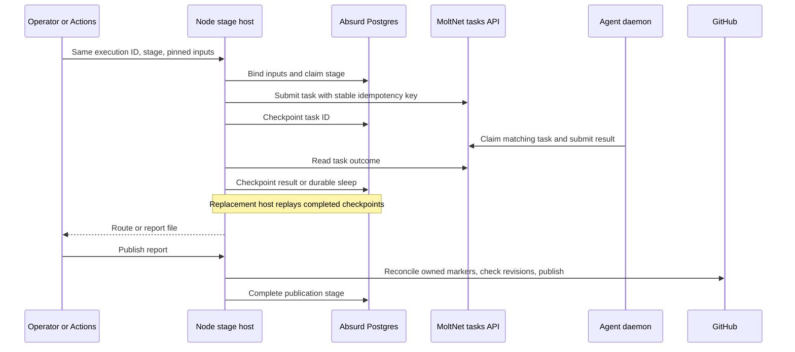

# Run and resume an adaptive review

Adaptive review classifies a pinned pull request, runs the selected review
lanes through MoltNet tasks, and publishes an advisory GitHub report. The Node
entry points used by the reusable Actions workflow persist `prepare`, `route`,
`review`, and `publish` execution in Absurd, a Postgres-backed workflow engine.
A replacement process can resume those stages with the same inputs and database.
`plan` is an ordinary read-only command; it does not create durable work.

Absurd is required for those executable stages, both locally and in Actions.
The exported library functions can still use an inline `WorkflowContext` for
embedding and unit tests; that mode has no durable recovery. Running outside
Actions removes the Actions dependency, not the database or task workers.

This describes the implementation in this checkout. MoltNet's
[caller workflow](../../.github/workflows/adaptive-review.yml) still selects a
released reusable workflow by commit SHA. Changing this source does not deploy
it: the action must be released, the caller pin updated, and the required
`ADAPTIVE_DATABASE_URL` secret configured. There is no optional non-durable
fallback in the stage CLI and no separate durable runner to select.

The stages can run outside Actions, including against another repository.
They remain GitHub-specific: preparation and freshness checks use `gh`, prior
findings use GitHub GraphQL, and publication uses the GitHub API. There is no
single `start-review` command or installed supervisor that launches the entire
pipeline and its workers.

The source audit was repeated against `main` at `222e8862e`. Before this change,
Actions used local stage processes, adaptive lanes used `Promise.allSettled`
and sleeping in-memory contexts, complexity constructed its own context, and
docs task creation lacked a durable creation checkpoint. Persistent MoltNet
tasks and Actions artifacts retained results but not coordinator progress.
The existing Node action stage host is reused here; the issue-lifecycle host
owns a separate issue workflow and is not adopted as a second review authority.

## Launch from a trusted runtime checkout

Use the repository's Node version from `.tool-versions`, pnpm, Git, and `gh`.
Build the bundle in a trusted MoltNet checkout containing this implementation:

```bash
pnpm install --frozen-lockfile
pnpm exec nx run @themoltnet/adaptive-review-action:build
export REVIEW_DIST="$PWD/packages/adaptive-review-action/dist"
```

The executable entry points are `review.js` and `publish.js` in that directory.
Keep the whole bundle, including shared chunks. This private workspace package
is not an independently installable review CLI. Run these files with Node from
the **reviewed repository's** checkout, keeping the runtime outside the PR's
control. Never build or execute the reviewed head to run its review.

Before launching, supply:

- An existing Postgres database initialized with a compatible Absurd schema.
  The stage host creates execution queues, but does not install or migrate the
  schema. The local e2e stack's `issue-lifecycle-db-migrate` service owns test
  schema setup; it is not a production provisioning command.
- A GitHub App token in `GH_TOKEN` with repository read access and, for
  publication, pull request write access. Set `ADAPTIVE_APP_LOGIN` to that
  token's App login, including `[bot]`. Tokens may be renewed on resume.
- MoltNet authentication with access to the selected team, diary, profiles, and
  tasks. The configless path uses `MOLTNET_AGENT_KEY` and an explicit
  `MOLTNET_API_URL`. Local identity stores and secret references follow
  [agent configuration](../../docs/reference/agent-configuration.md).
- Existing team-scoped runtime profiles and daemon workers with the matching
  models, provider credentials, and task permissions. The stage host submits
  tasks; it does not call the models or provision profiles and workers.
- A checkout of the target repository with the pinned base and head objects,
  their blobs, and a common ancestor available. Its base must contain
  `.github/adaptive-review.json`; the [policy guide](README.md) describes lane
  selection and trusted base guidance.

The following uses General work, without a MoltNet project binding. Substitute
real identifiers and provide secrets through your environment; the shell
checks deliberately avoid embedding them in the example:

```bash
: "${ADAPTIVE_DATABASE_URL:?set the Absurd database URL}"
: "${GH_TOKEN:?set the reviewer App token}"
: "${MOLTNET_AGENT_KEY:?set the MoltNet agent key}"
export MOLTNET_API_URL='https://api.themolt.net'
export MOLTNET_TEAM_ID='<team-uuid>'
export MOLTNET_DIARY_ID='<diary-uuid>'
export ADAPTIVE_APP_LOGIN='<reviewer-app>[bot]'
export ADAPTIVE_RUNTIME_SHA='<full commit SHA of the trusted runtime>'
export ADAPTIVE_MODE='active'
export ADAPTIVE_CLASSIFIER_PROFILE='<classifier-profile-uuid>'
export ADAPTIVE_FOCUSED_PROFILE='<focused-profile-uuid>'
# Set these as well when their lanes are enabled in the base policy:
# export ADAPTIVE_DOCS_PROFILE='<docs-profile-uuid>'
# export ADAPTIVE_COMPLEXITY_PROFILE='<complexity-profile-uuid>'
# export ADAPTIVE_SECURITY_PROFILE='<security-profile-uuid>'

export GITHUB_REPOSITORY='<owner/repository>'
export GITHUB_EVENT_NAME='issue_comment'
export GITHUB_EVENT_PATH='/absolute/private/review-state/event.json'
export ADAPTIVE_PREPARED='/absolute/private/review-state/prepared.json'
export ADAPTIVE_ROUTE='/absolute/private/review-state/route.json'
export ADAPTIVE_REPORT='/absolute/private/review-state/report.json'
export ADAPTIVE_EXECUTION_ID='<new UUID for this intentional review>'
export ADAPTIVE_RUN_URL='<stable URL where operators can inspect this run>'
```

Create the state directory before running the commands. To select PR 123 without
manufacturing a full webhook payload, put this JSON in `GITHUB_EVENT_PATH`:

```json
{ "issue": { "number": 123, "pull_request": {} } }
```

`prepare` initially fetches the PR through GitHub for this event shape. It
accepts a full `pull_request` payload as well. Its persisted result retains the
original eligibility decision and PR metadata; resuming the same execution
does not replace them with the latest PR title, body, or revisions. `PROTECTED_PATHS` is an optional newline-separated
list of paths that must not change. Preparation rejects fork and Dependabot PRs,
truncated file lists, and protected-path changes; it prints `skip=true` when
ineligible. Stop when it does so, even if an old prepared file exists.

From the target repository checkout:

```bash
ADAPTIVE_STAGE=prepare node "$REVIEW_DIST/review.js"
```

Read the prepared file's `base`, `head`, and `correlationId`. Make sure Git has
both revisions and their merge base before continuing. The existing
[head-fetch helper](../../tools/fetch-adaptive-review-head.sh) accepts
`BASE_SHA`, `HEAD_SHA`, and `GH_TOKEN`, and fetches/deepens `origin`; it assumes
the base object is already checked out. It can be used outside Actions with
`GITHUB_SERVER_URL` omitted for github.com. For another repository, `origin`
must refer to that repository, not the runtime checkout.

```bash
ADAPTIVE_STAGE=plan node "$REVIEW_DIST/review.js"
```

Stop if `review-enabled=false`. If `classifier-needed=true`, start the
classifier worker below **before waiting for route to finish**:

```bash
ADAPTIVE_STAGE=route node "$REVIEW_DIST/review.js"
```

Routing writes `ADAPTIVE_ROUTE` and prints a `specialists` JSON matrix. Start
workers for the selected profiles before waiting for review to finish:

```bash
ADAPTIVE_STAGE=review node "$REVIEW_DIST/review.js"
```

Review writes `ADAPTIVE_REPORT`. Inspect coverage and failures, then invoke the
publication entry point when publishing is intended:

```bash
node "$REVIEW_DIST/publish.js"
```

A failed lane makes the review command exit 1 **after writing its report**.
`unclear` and `screened` lanes can still produce exit 0; task completion and a
successful command are not review clearance. Publication can publish an
incomplete report. There is no implicit approval gate between these commands.

### Environment contract

| Setting                                                                             | Meaning                                                                                                                         |
| ----------------------------------------------------------------------------------- | ------------------------------------------------------------------------------------------------------------------------------- |
| `ADAPTIVE_DATABASE_URL`                                                             | Required for prepare, route, review, and publish; all replacements use the same database.                                       |
| `ADAPTIVE_EXECUTION_ID`                                                             | Optional preparation override for the correlation ID. Use a UUID; preserve it on resume.                                        |
| `ADAPTIVE_RETRY_FAILED=true`                                                        | Explicitly retries an Absurd stage that reached `failed`; does not refresh completed stages or failed lane results.             |
| `ADAPTIVE_MODE`                                                                     | Required `active` or `shadow`; shadow investigates every enabled lane.                                                          |
| `ADAPTIVE_RUNTIME_SHA`                                                              | Required runtime revision label, pinned as input. Operators must actually run that code; this string is not a code attestation. |
| `ADAPTIVE_CLASSIFIER_PROFILE`                                                       | Required profile name or ID, resolved in the selected team.                                                                     |
| `ADAPTIVE_FOCUSED_PROFILE`                                                          | Required when tests, conventions, blast-radius, or performance is enabled.                                                      |
| `ADAPTIVE_DOCS_PROFILE`, `ADAPTIVE_COMPLEXITY_PROFILE`, `ADAPTIVE_SECURITY_PROFILE` | Required for their respective enabled lanes.                                                                                    |
| `ADAPTIVE_TASK_BUDGETS`                                                             | Optional YAML overrides; see [task budgets](README.md#findings-and-outcomes). Keep resolved limits unchanged on resume.         |
| `MOLTNET_PROJECT_ID`                                                                | Optional task project scope. Workers need the matching project binding; omitting it uses General work.                          |
| `ADAPTIVE_PREPARED`, `ADAPTIVE_ROUTE`, `ADAPTIVE_REPORT`                            | Prepared input, routing output, and report file paths. Parent directories must exist.                                           |
| `ADAPTIVE_APP_LOGIN`                                                                | Required for review history and publication attribution.                                                                        |
| `ADAPTIVE_RUN_URL`                                                                  | Required for publication; use a stable URL across retries.                                                                      |
| `ADAPTIVE_INLINE_FINDINGS=false`                                                    | Disables inline threads; all other values retain inline publication.                                                            |
| `GITHUB_API_URL`, `GITHUB_GRAPHQL_URL`                                              | Optional REST and GraphQL overrides. Configure `gh` separately for the same GitHub host.                                        |
| `GITHUB_OUTPUT`, `GITHUB_STEP_SUMMARY`                                              | Optional Actions output/summary files. Without an output file, stage outputs go to stdout.                                      |

Profile IDs and the revisions returned by the profile API are pinned. A
changed revision is rejected on resume. Task claims currently select profiles
by ID, however, not by historical revision: this layer cannot force a daemon
to execute an older profile revision. Keep profiles stable while tasks remain
outstanding; revision checks are not an immutable provider/model snapshot.
The `providers` YAML accepted by the Actions workflow is an action input,
**not** an environment variable consumed by `review.js`.

## Workers and lifetime

Two kinds of worker participate:

1. Each Node stage starts an **Absurd worker** for its execution queue, waits for
   that stage's result, then closes the worker and database client. It resumes
   coordinator checkpoints and timers. It never performs model inference.
2. A **MoltNet agent daemon** claims the classifier or specialist tasks through
   the MoltNet API, runs the configured runtime, and reports task attempts.

Install and configure `moltnet-agent` using its
[operator documentation](../../apps/agent-daemon/README.md). For a configless
worker, supply `MOLTNET_AGENT_NAME`, `MOLTNET_AGENT_KEY`, `MOLTNET_API_URL`,
`MOLTNET_TEAM_ID`, and `MOLTNET_PRIVATE_KEY`, plus model-provider configuration.
The private key is used for executor attestation. Set `REVIEW_CORRELATION_ID`
to `correlationId` from the prepared file. Run workers in a checkout containing
the same pinned Git data as the coordinator:

```bash
moltnet-agent drain \
  --agent "$MOLTNET_AGENT_NAME" --team "$MOLTNET_TEAM_ID" \
  --profile "$ADAPTIVE_CLASSIFIER_PROFILE" --task-types classify \
  --correlation-id "$REVIEW_CORRELATION_ID" \
  --wait-for-first-task-sec 900 --wait-after-task-sec 120 \
  --max-poll-interval-ms 3000
```

For each selected specialist profile, run the same command with
`--task-types freeform` and that profile. The Actions matrix creates one worker
per runnable lane, grouped by profile. Focused workers use
`--wait-after-task-sec 0`; docs, complexity, and security use `120` because
those lanes can submit successive stages. A worker waiting 900 seconds for its
first task exits if none arrives. These are finite drain workers, not an
always-on service. For project-scoped tasks, replace the General-work team
selection with a matching `--config-file` / `--binding`; see
[project selection](../../apps/agent-daemon/README.md#project-selection-for-once-poll-and-drain).

Restart a departed daemon with the same team, correlation, project scope, and
profile to claim remaining eligible work. This does not reset task expiry or
guarantee that an interrupted model attempt is reused. MoltNet owns task claims,
attempts, acceptance, and execution deadlines; the adaptive coordinator resumes
waiting for those records. Re-running the coordinator does not launch a daemon.

The Actions wrapper gives route and review jobs 55 minutes and worker jobs
60 minutes. Workers that leave do not immediately fail the durable coordinator:
the CLI intentionally does not attach Actions job liveness to persisted work.
Task dispatch/execution/expiry budgets remain authoritative across replacement
Actions attempts. Outside Actions, the operator supplies process lifetime and
restart policy.

## What persists and how resume works



The correlation ID identifies an intentional review across its MoltNet tasks,
report, and publication markers. The Absurd queue is
`adaptive-<first 24 hex characters of SHA-256(correlationId)>`; a companion
`-input` queue holds immutable per-stage input bindings. Stage tasks are named
`adaptive_review_stage_v1:prepare`, `:route`, `:review`, and `:publish`. The stage name is
the spawn idempotency key within this execution. The resulting Absurd task ID
is distinct from both the correlation ID and each MoltNet task ID.

Preparation uses `ADAPTIVE_EXECUTION_ID` when supplied. In Actions it otherwise
derives a stable correlation ID from repository name and `GITHUB_RUN_ID`,
excluding `GITHUB_RUN_ATTEMPT`. Outside Actions, without either value, it
creates a random UUID. Re-running preparation without preserving an ID therefore
starts a new review.

To resume, keep the execution ID and original environment, reconnect to the
same database, and rerun the interrupted stage command. If the prepared file
is missing, rerun preparation with the same ID, repository, PR number, and
`PROTECTED_PATHS`; it restores the original prepared result. Keep the same runtime
bundle, base/head objects, mode, team/diary/project, profile IDs and revisions, task budgets,
and PR title/body. Renew credentials if necessary. Stage input binding compares
canonical JSON before claiming work and refuses incompatible inputs. Route
and review also validate policy/reference digests and the pinned handoff.
Credentials and checkout paths are not persisted as input.

Prepared inputs and route/review results live in Absurd as well as local JSON
files. If a process dies before writing a completed result file, rerunning that
stage reconstructs the file from the stored result, provided its input checks
still pass. Restore prepare, route, and review in order when all files are lost.
Completed route/review stages can restore their files after the PR moves, so
publication can reconcile old output. Unfinished routing or review work checks
the current PR revisions before continuing and refuses stale work. `plan`
reads the pinned Git data; it is not a current-revision approval gate.

A replacement host waits for an existing claim to become available; recovery
is not instantaneous. Absurd owns claim leases and retry scheduling, with
three stage attempts by default. Completed child steps replay without
re-submitting their effects. MoltNet task creation uses stable idempotency keys
so a response lost after server acceptance can recover the same task. Polls
read fresh task state; durable sleeps release the orchestration run between
polls. Completed parallel lane results and bounded repairs are checkpointed.

Use `ADAPTIVE_RETRY_FAILED=true` only to retry a failed orchestration stage with
the original inputs. A completed review containing failed or incomplete lanes
is still a completed Absurd stage: retrying it returns that report. To request
a fresh assessment, choose a **new** correlation ID, prepare again, and use new
state files. New reviews create new MoltNet tasks even for the same revision.
Do not reuse an ID to change inputs or upgrade the runtime mid-execution.

### Resume in Actions

Re-run **all jobs** of the original run so preparation restores its inputs and
worker jobs can reconnect, rather than re-running only a failed coordinator:

```bash
gh run rerun <run-id> --repo <owner/repository>
```

The run ID stays the same; the incremented attempt enables retry of a failed
Absurd stage. A new authorized `/review` request creates a new Actions run and
therefore a new execution. Retain the original workflow/runtime revision and
profile revisions. A completed report with failed lanes remains that report;
rerunning is not a request for more review budget.

Keep both execution queues and their task/checkpoint records for as long as
resume is required. There are two queues per execution, so database retention
must account for that growth. No automatic queue cleanup is added here.

## Publication recovery

Publication binds the report, expected identity, run URL, App login, and inline
setting. It checks the current PR revisions before writes and again afterward.
On replay, it reads existing App-owned summary comments and review threads.
Location keys prevent repeating existing findings; resolved findings remain
in the summary. Execution markers identify this run's output for stale cleanup.

If GitHub accepted a write before the process lost its response, rerunning
`publish.js` reconciles that external state. If the PR is now stale, recovery
removes this execution's marked inline comments and replaces its own summary
with a stale notice, then fails. It does not overwrite a newer execution's
marked summary during stale recovery. GitHub rejecting inline anchors with
HTTP 422 falls back to summary-only findings.

This is reconciliation, not a transaction spanning GitHub and Postgres. The
implementation does not promise exactly-once GitHub writes under arbitrary
concurrent publishers or visibility delays. Once publication has completed in
Absurd, replay returns its stored result; it does not continuously monitor the
PR or withdraw findings after every future push. Keep publishing for one PR
serialized at the supervisor boundary.

## Supervisor responsibilities and verification limits

Absurd persists coordinator state; it does not keep a Node process alive,
recreate checkouts, refresh App tokens, restore local handoff files, start
MoltNet daemons, or advance from one CLI stage to the next. Actions currently
provides those process and artifact handoffs through job dependencies. A host
outside Actions must supply them, retain the execution ID, and run each stage
with its original inputs. No database-only background service continues a
review after every host and daemon has exited.

Actions remains responsible for event authorization, protected-path eligibility,
trusted runtime checkout and digest validation, worker provisioning, artifacts,
and publication tokens. Preparation alone does not authorize an `issue_comment`
request: the caller workflow enforces the `/review` text and commenter checks.
An external supervisor must decide who may launch a review and publish it.

[Recovery unit tests](__tests__/recovery.spec.ts) simulate checkpoints, lost
responses, completed parallel branches, and repair replay. Publication tests
mock GitHub. These establish local contracts, not recovery against deployed
services. The
[adaptive recovery integration suite](__tests__/recovery.integration.spec.ts)
uses child processes and a real Absurd database, with simulated MoltNet task
execution. It belongs to adaptive review and runs separately from unit tests.
It does not exercise GitHub or live model workers. Run it only with an already
initialized test database:

```bash
NX_LOAD_DOT_ENV_FILES=false \
ADAPTIVE_TEST_DATABASE_URL='<Absurd test database URL>' \
pnpm exec nx run @moltnet/adaptive-review:test:integration
```

The target is not cached and never starts or migrates a database. It requires
the explicit test URL and uses isolated execution queues, removed after each
test. CI runs it in the existing database-only orchestration job alongside the
shared adapter tests. A complete local review instead uses the stage commands
and real daemon workers described above, producing `ADAPTIVE_REPORT` before
the separately invoked publication command.

| Recovery condition                             | Local evidence                                                                                                                   | Real Absurd coverage                                 |
| ---------------------------------------------- | -------------------------------------------------------------------------------------------------------------------------------- | ---------------------------------------------------- |
| Submission accepted before creation checkpoint | Replay test asserts repeated key returns same task ID and counts requests                                                        | SIGKILL creation case passed                         |
| Restart while awaiting                         | Replay keeps the waiting task ID                                                                                                 | SIGKILL awaiting case passed                         |
| Some parallel lanes complete                   | Replay retains completed lane checkpoint and three total submissions                                                             | SIGKILL partial-lane case passed                     |
| Interrupted semantic repair                    | Replay retains original plus two bounded corrections, including crash-gap retry count                                            | SIGKILL repair case passed                           |
| Resume budgets and spend inputs                | Saved classifier deadline, same task requests and repair cap, restored task-ID ledger, and all five priced attempts counted once | Task ID/request counts passed; live usage unverified |
| Intentional new review                         | Distinct execution/correlation produces distinct tasks; Actions attempt preserves identity                                       | New stage execution case passed                      |
| Incompatible inputs                            | Rejects changed repository, head, profiles/revisions, budgets, runtime                                                           | Binding case passed                                  |
| Publication interruption or moved revision     | Mock GitHub tests cover lost summary/thread responses and own-output stale cleanup                                               | No live GitHub recovery test                         |

The real-Absurd integration suite was run locally against an isolated
Postgres with Absurd schema `0.4.0`. The process tests killed and replaced
coordinators and verified preserved task IDs and submission counts. A sixth
case ran `prepare`, `plan`, `route`, and `review` through the local stage
interface for a separate repository fixture. It deleted the prepared, route,
and report files, then restored all three from Absurd with the same three
task IDs and no additional submissions. This caught and now guards against
JSON object-key ordering differences at the route-to-review handoff. GitHub
responses and MoltNet task execution remain simulated: this does not verify
live provider behavior, GitHub publication recovery, deployed credentials, or
production readiness. Before relying on this path operationally, validate a
controlled review against the intended database and worker deployment.
