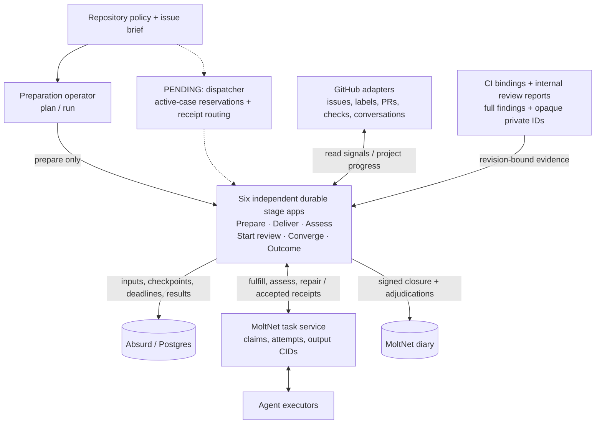
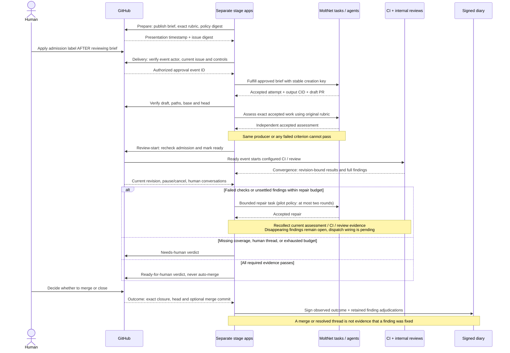

# SDLC: from an approved issue to a recorded outcome

`@moltnet/sdlc` provides the stages and decision rules for agent-assisted software
delivery. It turns an issue brief into a draft pull request, asks an independent
agent to assess the result, gathers CI and review evidence, and records the
human's final merge or closure decision in signed memory. SDLC means software
development lifecycle.

The library implements six independently recoverable stages. A preparation
command can publish a brief today, and local integration tests connect all six
stages. **There is no production dispatcher connecting them yet.** This is not a
command that autonomously takes an issue through to merge. Human approval starts
delivery, and a human decides whether to merge; no stage merges a pull request.

Before replacing the whole-issue workflow in `apps/issue-lifecycle`, the rollout
still needs active-case
reservations, downstream dispatch, trusted CI and review dispatch receipts,
immutable runtime-profile revision pinning, and a supervised live GitHub pilot.
The policy parser and preparation operator exist; their limits alone do not
enforce the number of active cases or spending across the lifecycle.

## Architecture

A **case** is the work associated with an issue and its proposed change. Each
stage processes part of that case and returns evidence for the next stage.

| Component                          | Responsibility                                                                                                           |
| ---------------------------------- | ------------------------------------------------------------------------------------------------------------------------ |
| Repository policy                  | Selects approval permissions, labels, allowed paths, executors, required evidence, and limits.                           |
| GitHub adapters                    | Read issues, approvals, PR revisions, checks, and conversations; publish progress and mark validated drafts ready.       |
| MoltNet task service and executors | Claim and run delivery, assessment, and repair tasks; retain accepted attempts and their outputs.                        |
| Absurd, backed by Postgres         | Persist each stage's inputs, checkpoints, deadlines, and result so a replacement worker can resume it.                   |
| MoltNet diary                      | Retain signed closure facts and finding decisions.                                                                       |
| Dispatcher (unfinished)            | Reserve active cases, start the next stage, and retain trusted receipts binding CI and review runs to the approved work. |

Labels and the case status comment show progress. They are not execution locks.
MoltNet claims coordinate executors, and Absurd checkpoints coordinate a stage's
recovery. Worker concurrency does not bound cases waiting between stages. No
second case-management database is introduced by this library.

Solid arrows below are implemented interfaces. Dashed arrows are unfinished
operational wiring. The local integration test connects the stages explicitly.



## The six stages

| Stage          | Input and action                                                                                            | Handoff                                                                        |
| -------------- | ----------------------------------------------------------------------------------------------------------- | ------------------------------------------------------------------------------ |
| Prepare        | Normalize the brief and its exact acceptance rubric; publish them in the issue's status comment.            | Frozen brief and trusted presentation receipt.                                 |
| Deliver        | Verify an authorized approval made after presentation, then request `fulfill_brief` work.                   | Accepted task output identifying a current draft PR within the approved paths. |
| Assess         | Ask a different agent to assess the accepted delivery using the original rubric. Every criterion must pass. | Accepted independent assessment bound to the PR revision.                      |
| Start review   | Recheck delivery, assessment, approval, paths, and revision; mark the draft ready.                          | A ready PR that can trigger configured CI and review.                          |
| Converge       | Gather current assessment, CI, review findings, and human conversations; request bounded repairs if needed. | A verdict and retained finding ledger; `ready` means ready for human review.   |
| Record outcome | Observe a merged or unmerged PR closure and verify its provenance.                                          | Signed diary entry separating closure facts from finding decisions.            |

A **receipt** records evidence of an external operation or accepted result so a
later stage can verify it and a retry can recover it. An accepted task receipt
identifies the task, accepted attempt, and output **CID** (content identifier).
A **revision** includes the base and head commits plus digests of the approved
brief and policy. A green check for the same head commit is insufficient if it
cannot be bound to that full revision. A correlation ID links the stage tasks.

The sequence below describes the implemented contracts, not a single deployed
workflow. In the integration test, GitHub responses and agent completions are
fixtures; MoltNet and Absurd are real local services.



## Try the preparation operator

With workspace dependencies installed, use `@moltnet/tools:sdlc:prepare` to
inspect a dispatch plan offline or publish a brief to GitHub. The examples
contain placeholder team, diary, App-user, profile, correlation, and issue IDs;
they are not deployment settings.
Replace them with your selected agent's repository-scoped configuration before
running against GitHub. Keep that configuration outside version control when it
contains operational details you do not intend to publish.

From the workspace root, inspect an offline example:

```bash
NX_LOAD_DOT_ENV_FILES=false pnpm exec nx run @moltnet/tools:sdlc:prepare -- plan ../libs/sdlc/examples/pilot-policy.json ../libs/sdlc/examples/preparation-request.json
```

Paths are relative to `tools/`, where Nx executes the target. `plan` validates
configuration and the rubric, then prints the effective input, policy snapshot,
brief digest, and deterministic dispatch key without connecting to GitHub or a
database. Policy fields are strict: misspellings fail, admission requires write
or admin permission, labels must be disjoint, and paths are exact files or
directory prefixes rather than globs. Pilot policy allows at most two repair
rounds and two active cases. Convergence enforces its persisted repair budget.
The active-case limit is validated configuration; reservations and lifecycle-wide
spending enforcement are not implemented. Runtime profiles currently bind IDs;
immutable profile-revision pinning remains required for rollout.

For `run`, select `ABSURD_DATABASE_URL` and an isolated
`SDLC_PREPARATION_QUEUE` explicitly, and run from a checkout whose GitHub origin
matches the policy repository. Use absolute paths to your configured files:

```bash
NX_LOAD_DOT_ENV_FILES=false pnpm exec nx run @moltnet/tools:sdlc:prepare -- run /absolute/path/policy.json /absolute/path/request.json
```

The request's `issueDigest` is `issueDigest({title, body})` from the GitHub
adapter, computed from a fresh issue read. The stage refuses publication if the
issue changes. The released `moltnet github exec` wrapper supplies the activated
agent's repository-scoped App token; no human-token fallback is used. Bodies
travel through stdin without shell interpolation. The command prints the
Absurd task receipt before waiting, so interrupted operators can inspect the
same execution. The command's wait timeout does not cancel the durable task.
Retry the exact same plan to recover it; do not change queues when recovering.
Serialize preparation for a given issue: distinct changed briefs are distinct
executions, and GitHub comments are not locks.

Preparation only presents a brief. It does not grant admission or start delivery.
The human admission event must follow the presentation. The policy snapshot is
stored in the queued task parameters for subsequent dispatch validation. The
operator still needs to review the policy file as well as the presented rubric.
This command does not dispatch any later stage.

## Admission and handoff contracts

Handoffs carry the issue identity, approval generation, correlation ID, full
revision, and accepted task attempt/output CID. A pause, cancellation, changed
brief, or changed revision can invalidate the next action. Before mutations,
the consuming workflow must validate external payloads and re-read relevant
revision and control state. GitHub writes are not transactional with those
reads: an in-flight change may produce an intermediate projection that must be
detected and reconciled.

`admit` requires an eligible open work item and authorized approval bound to its
current brief digest. The adapter establishes actor authority from provider
data and binds the approval event to the earlier presentation. Label presence
alone is insufficient. The event ID supports durable duplicate-delivery
reconciliation; `admit` itself is neither an atomic claim nor a deduplication
store.

`reconcileStageLabels` computes additions and removals using repository policy
and preserves unrelated labels. The adapter reconciles partial writes before
publishing a completed handoff. Pure decision functions do not enforce executor
identity or close gaps between external writes and local checkpoints.

### GitHub approval and progress

`@moltnet/sdlc/github` binds an authenticated request function to issue reads and
granular label writes. `syncGithubStage` re-reads actual labels on retry, checks
issue contents and stop labels between writes, and verifies the final
projection. A successful write whose acknowledgement was lost is reconciled
from provider state rather than blindly repeated. The owning workflow must
serialize stage publishers and reconcile superseded projections.

`approvalAfterBrief` requires a complete admission-label timeline in provider
order and an independently trusted presentation record. It rejects stale,
removed, unauthorized, ambiguous-time, and changed-issue approvals.
`readGithubApproval` paginates issue events, checks the latest actor's repository
permissions and immutable user ID, and re-reads the issue before returning
provenance. Allowed permissions come from policy. These checks establish
current authority, not historical authority. Incomplete history or ambiguity at
the latest event fails closed; an older ambiguous relabel does not invalidate a
later unambiguous approval. Arbitrary comments do not establish authority.

Preparation persists the presentation receipt; the operational dispatcher must
serialize admission. GitHub reads and subsequent task creation are not atomic.
See GitHub's [issue events](https://docs.github.com/en/rest/issues/events#list-issue-events)
and [repository permissions](https://docs.github.com/en/rest/collaborators/collaborators#get-repository-permissions-for-a-user)
contracts.

### Preparation, delivery, and assessment

`createGithubPreparationApp` freezes the normalized brief and exact rubric and
maintains the case's GitHub status comment. The provider's comment update time
becomes the presentation receipt. `createGithubMoltNetDeliveryApp` consumes that
receipt, requires a subsequent authorized admission event, and creates the task
with a stable operation key. Accepted output must identify a current
same-repository draft whose complete changed-file set stays within approved
paths, including both sides of renames.

`createGithubMoltNetAssessmentApp` rechecks approval, issue controls, and the
current draft before dispatch and while polling. Its underlying
`createAssessmentApp` sends an `assess_brief` task referencing the accepted
delivery attempt and output CID. It copies the original rubric and rejects a
judgment by the producing agent. Every criterion must pass; an average cannot
hide an individual failure. The evidence binds the original base, head, policy
digest, and brief digest.

### Starting review

`createGithubMoltNetReviewStartApp` verifies both accepted task receipts, the
original rubric, assessor identity and runtime profile, current admission,
paths, and revision before marking the draft ready. Self-assessment cannot
start CI. A lost mutation acknowledgement is reconciled against current PR state
without repeating the mutation.

GitHub's ready mutation has no expected-head condition. A concurrent push or
revoked admission can race it. The adapter re-reads and refuses a successful
handoff if state changed, but cannot prevent an intermediate ready state.
Downstream evidence must still bind the exact revision.

## Convergence and findings

**Convergence** decides whether the current change has enough evidence for a
human review, needs repair, must wait, or needs human intervention. A **review
lane** is a category such as documentation, tests, or security; policy selects
which lanes are required. A **finding ledger**
retains observed problems across polling and repair rounds so omitted findings
do not silently disappear.

`evaluateConvergence` binds assessment, checks, reviews, and finding verification
to the same base, head, policy, and brief. Required checks and lanes come from
validated policy; audit lanes add coverage to selected review lanes.

| Evidence or control state                                               | Decision                                           |
| ----------------------------------------------------------------------- | -------------------------------------------------- |
| Missing or stale evidence                                               | Wait for current evidence.                         |
| Incomplete coverage or human-authored conversations needing disposition | Require a human.                                   |
| Failed checks or unsettled findings, with repair budget left            | Request repair.                                    |
| Exhausted repair budget                                                 | Require a human.                                   |
| All required evidence passes                                            | Ready for human review, never permission to merge. |

Every current review contributes findings, including optional lanes and findings
without line anchors. Fixed and rejected findings need current verification;
only verified pre-existing findings may be deferred. Conflicting dispositions
remain open. A finding absent from a later report remains unsettled until
explicit verification fixes, rejects, or permits a pre-existing follow-up.

Verdicts expose identifiers and reason codes, not finding content. Private
findings use opaque IDs; security finding text stays in team-scoped tasks. The
terminal result retains the full ledger for outcome recording, while the public
publication port receives only the revision and verdict codes. Observing a merge
or a resolved thread does not establish that a finding was fixed.

### Evidence collection

`createGithubEvidenceObserver` combines independent assessment, GitHub checks,
internal adaptive-review reports, and human review conversations. It reads the
revision and control state before and after collection and discards mixed
snapshots. Missing conversation coverage is a gap, not zero unresolved threads.
Human replies to bot-created threads count; all thread and comment pages are
read until coverage or a blocking human participant is found.

CI requires a trusted dispatch receipt binding suite and App IDs to the full
SDLC revision. The collector reads the suite's latest check attempts and
requires exact names and identities. Missing checks wait. Duplicate names,
skips, cancellations, neutral conclusions, and incomplete pagination cannot
pass. The dispatcher must persist bindings when scheduling CI; a green badge or
head SHA cannot supply them. See GitHub's
[check-run API](https://docs.github.com/en/rest/checks/runs).

Review bindings retain both SDLC and review-specific policy digests, runtime
revision, and correlation ID. The converter consumes full internal reports,
including unanchored findings and opaque private IDs; it does not scrape public
comments. Screening supplies no review evidence. A full audit can supply that
lane, but another passing report cannot hide incomplete or contradictory
evidence.

## Durable execution and recovery

A **port** is the interface through which a stage reads evidence or performs an
external operation. Its implementation must reconcile an existing operation by
stable key before deciding whether a new operation is still authorized. This
handles a crash after an external write succeeds but before the stage saves its
checkpoint.

### Convergence execution

`createConvergenceApp` registers `sdlc_convergence_v1` independently of intake and
delivery, binding a change key to a `ConvergencePort`. It persists limits,
deadlines, terminal evidence decisions, repair receipts, the finding ledger,
and outcomes. Repair creation, cancellation, and publication use stable keys.
Evidence polling uses durable sleeps, not immutable Absurd events as a stream.
Repair counts survive replay; semantic failures escalate instead of consuming
hidden retries.

Pause, cancellation, or changed brief/policy cancels further repair work. The
returned `published` flag distinguishes a current published verdict from a
superseded publication attempt. The consuming workflow owns persisted repair
counts and current-state checks; the pure decision function does not.

### MoltNet task operations

`@moltnet/sdlc/moltnet` uses the SDK with explicit team context on every request.
It locates lost creation acknowledgements by an operation-specific tag scoped
to the proposing agent and team, then replays creation with the original
idempotency key. The server checks body agreement and owns concurrent-create
uniqueness. Operation tags are reserved for this adapter. Task bodies must use
a persisted policy snapshot rather than fresh timestamps or mutable
configuration; the original case correlation is preserved across stage tasks.

New repairs require a fresh caller-supplied admission check. That check and
remote task creation are not atomic, so workers must enforce current controls
and revision before repository writes. Cancellation revokes the task and
reconciles lost acknowledgements, but cannot undo an external Git write already
in flight. Cancellation retries until a fresh read establishes terminal state.
A completed task counts as accepted only with its accepted completed attempt,
output CID, and caller-validated output.

### Signed outcome recording

`createGithubMoltNetOutcomeApp` independently records a merged or unmerged PR
closure. Before signing, it verifies exact provider closure time, head, and
merge commit, plus the accepted delivery attempt, output CID, correlation, team,
and diary. Closure facts and finding adjudications stay separate.

The workflow freezes its body and checkpoints a signing request before invoking
the signer, then reuses that request for entry creation. The server's unique
content-signature constraint prevents duplicate entries for the saved request.
Reconciliation validates the operation tag, content CID, creator, and entry
signature. An existing valid entry can be recovered even if the PR later reopens.

The dispatcher must use one idempotent Absurd execution per closure; diary tags
do not serialize separate concurrent executions. A crash before saving a new
signing-request receipt can leave an unused request that expires, but cannot
create an entry because signing begins only after the checkpoint. Expired or
rejected saved requests fail explicitly. This adapter records PR closures;
generic cancellation observations require another adapter.

## Validation and rollout evidence

Run library checks from the workspace root:

```bash
pnpm exec nx run-many -t test lint typecheck --projects=@moltnet/sdlc
```

The tests establish different boundaries:

| Suite                     | What it exercises                                                                                                            | What it simulates                                                    |
| ------------------------- | ---------------------------------------------------------------------------------------------------------------------------- | -------------------------------------------------------------------- |
| Library and adapter tests | Decision rules, alternate label conventions, approval ingestion, and lost acknowledgement handling.                          | Provider and SDK responses.                                          |
| Orchestration E2E         | A real Absurd app and database; killing a worker after a repair write and recovering with one repair effect.                 | A database-backed repair service.                                    |
| REST API E2E              | Separate stage apps using real local MoltNet authentication, task profiles, claims, accepted outputs, and signed completion. | GitHub responses, internal review reports, and executor completions. |

The REST API case covers lost task-create and ready acknowledgements,
self-assessment rejection, independent assessment, and evidence collection. It
carries an opaque private finding through convergence into signed closure while
leaving it open after a merge. Lost signing and entry-creation acknowledgements
recover to one signature and one valid entry.

These are not live model-driven GitHub pilots. Production replacement still
requires the dispatcher and evidence bindings described above, followed by a
supervised live pilot.
