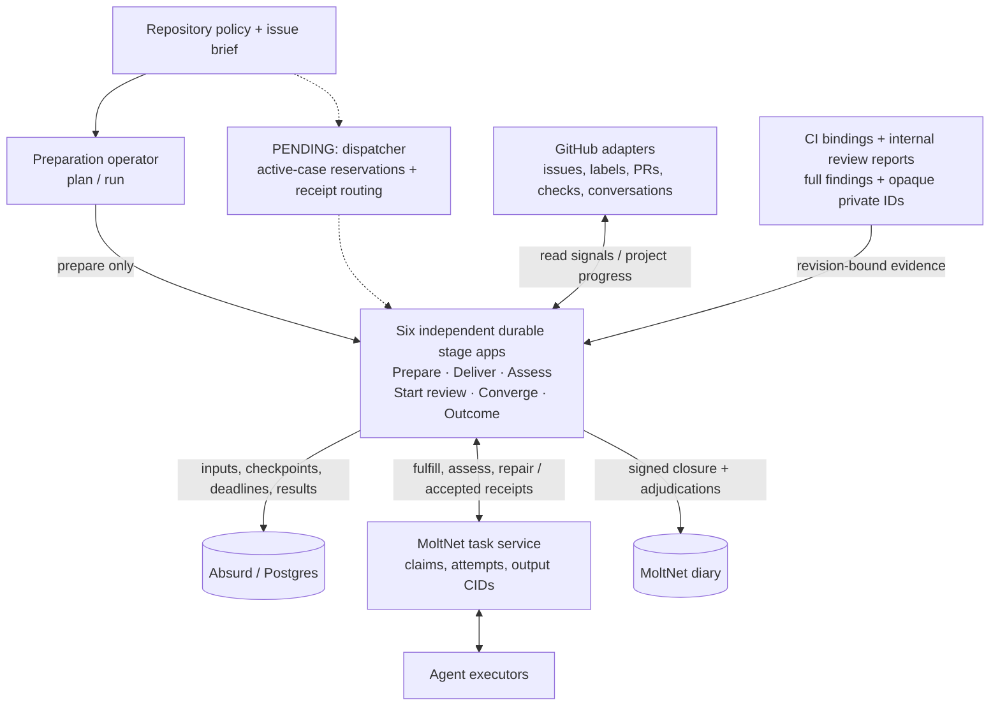
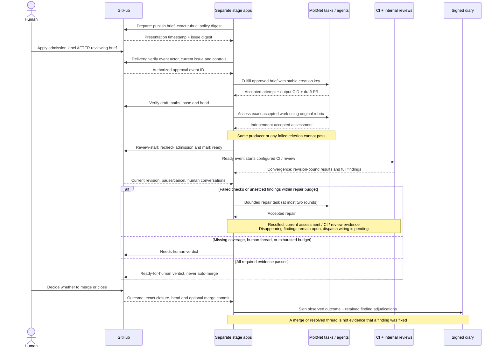

# SDLC stages and rollout

The replacement separates brief preparation, delivery, independent assessment,
review start, convergence, and outcome recording into independent durable
stages. GitHub supplies repository signals and shows progress; MoltNet owns
agent tasks and signed memory; Absurd persists stage execution and recovery.

## Architecture

Solid arrows show implemented interfaces. Dashed arrows show operational
coordination still to be built. The local integration test connects the stage
applications explicitly; there is no production dispatcher connecting them yet.



Labels and the case comment are progress projections, not locks. Task claims
coordinate executors; Absurd checkpoints coordinate each durable stage.
The pending dispatcher must reserve active cases and retain trusted dispatch
receipts for CI and review. Worker concurrency alone does not bound cases
waiting between stages.

## Signals and handoffs

This sequence describes the stage contracts exercised by the integration test.
The dashed architecture wiring above remains pending; the sequence is not one
whole-lifecycle workflow. GitHub responses and agent completions are fixtures in
that test, while MoltNet and Absurd use real local services.



The handoff carries the issue identity, approval generation, correlation ID,
base/head, policy/brief digests, and accepted task attempt/output CID. Evidence
must match that revision. Every mutation rechecks the relevant current state;
a pause, cancellation, changed brief, or changed revision can invalidate the
next action. External operations reconcile lost acknowledgements before retrying.
GitHub mutations are not transactional with these checks, so a concurrent change
can create an intermediate projection that must be detected and reconciled.

`admit` accepts only an eligible open work item with an authorized approval
bound to its current brief digest. The adapter must establish actor authority
from provider data and associate the approval event with the brief presented
before that event. A label's presence alone is insufficient. The event ID is
retained for durable duplicate-delivery reconciliation; this function is not
an atomic claim or a deduplication store.

`reconcileStageLabels` computes granular additions and removals from the
repository's label mapping. Unrelated labels are preserved. The adapter owns
writes and must reconcile partial failures before publishing a completed
handoff. Stage labels describe durable progress; they do not grant ownership.

`evaluateConvergence` binds assessment, checks, reviews, and finding
verification to the same base, head, policy, and brief. Required checks and
review lanes come from the caller's validated policy. Audit lanes add coverage
to the selected review lanes. Missing or stale evidence waits, incomplete
coverage requires a human, and failed checks or unsettled findings require
repair within the persisted budget. Human-authored conversations require a
human disposition. A ready result means ready for human review, never permission
to merge.

Every current review contributes findings, including optional lanes and
findings without line anchors. Fixed and rejected findings require current
verification evidence. Only verified pre-existing findings can be deferred.
The verdict emits identifiers and reason codes rather than finding content;
callers must use opaque identifiers for private findings.

The consuming workflow must persist repair counts, validate external payloads,
and re-read the revision and control state before every mutation. These pure
functions neither enforce executor identity nor close external crash gaps.
Accepted task references, MoltNet claims, and Absurd checkpoints remain the
execution primitives; no second case-management database is introduced here.

## Validation

Run `pnpm exec nx run-many -t test lint typecheck --projects=@moltnet/sdlc`.
Tests exercise decision behavior with different repository label conventions.
The orchestration suite tests process recovery, and the REST API E2E suite
tests real task-service integration. Live GitHub pilot validation remains
required before replacing the legacy runner.

## GitHub adapter experiment

The separate `@moltnet/sdlc/github` entry point binds an authenticated request
function to issue reads and granular label writes. `syncGithubStage` re-reads
actual labels on retry, checks issue contents and stop labels between writes,
and verifies its final projection. A lost acknowledgement after a successful
write therefore does not require replaying the original mutation list.

GitHub label writes are not transactional. A pause or edit can race an in-flight
write; the adapter detects supersession on its next read, but cannot promise
that no intermediate label was written. The owning workflow must serialize
stage publishers and reconcile any superseded projection. Labels never serve
as an execution lock or a successful handoff receipt.

`approvalAfterBrief` consumes a complete admission-label timeline in provider
order and an independently trusted brief-presentation record. It rejects stale,
removed, unauthorized, ambiguous-time, and changed-issue approvals. `readGithubApproval` fetches paginated issue events, verifies the latest actor
against repository permissions and immutable user ID, and re-reads the issue
before returning admission provenance. The allowed base permissions are policy
inputs. Permission checks establish current authority, not historical authority.
Incomplete history or ambiguity at the latest event fails closed. An older
ambiguous relabel does not invalidate a later unambiguous approval. The
preparation stage persists the trusted brief-presentation receipt. The
operational runner must serialize admission. The helper deliberately does not
infer authority from arbitrary comments.

Adapter tests simulate API responses and a lost write acknowledgement. They do
not constitute live GitHub or real-process durability tests.

## Durable convergence stage

`createConvergenceApp` registers `sdlc_convergence_v1` independently of intake
and delivery. Each execution binds a change key to a `ConvergencePort`. The
workflow persists limits, deadlines, terminal evidence decisions, repair
receipts, and outcomes. Repair creation, cancellation, and publication receive
stable operation keys. A port must reconcile an existing operation by key
before checking whether a new operation is still authorized and current.

Evidence is polled with durable sleeps. The workflow does not use immutable
Absurd events as a stream. Repair counters survive replay; semantic failures
escalate rather than consuming hidden retries. A pause, cancellation, or changed
brief/policy cancels further repair work. Ready means ready for human review.
The returned `published` flag distinguishes a current published verdict from a
superseded publication attempt.

The orchestration E2E harness exercises the actual app factory with a real
Absurd database: it kills a child worker after an external repair record is
written and before checkpoint persistence, starts a replacement, and verifies
one repair effect and successful completion. This test uses a database-backed
fake repair service. Separate REST API E2E tests exercise the real MoltNet task
service with simulated GitHub responses.

## MoltNet repair adapter

The separate `@moltnet/sdlc/moltnet` entry point uses the SDK with explicit team
context on every request. It locates lost creation acknowledgements using an
operation-specific tag, scoped to the proposing agent and team. The original
case correlation is preserved across stage tasks. It then
replays creation with the original idempotency key so the server checks body
agreement and owns concurrent-create uniqueness. The body builder must use a
persisted policy snapshot; it must not incorporate fresh timestamps or mutable
configuration. Operation tags must be reserved for this adapter.

New repairs require a fresh admission check supplied by the caller. This check
and remote task creation are not one atomic transaction; workers must enforce
current control and revision before repository mutations. Task cancellation
revokes the MoltNet task and reconciles lost acknowledgements, but cannot undo
an external Git write already in flight.

A completed task counts as accepted only with its accepted completed attempt,
output CID, and caller-validated output. Cancellation is retried unless a fresh
read establishes terminal state. SDK adapter tests cover these contracts;
the real local task-service E2E suite also covers these contracts. A live
GitHub pilot remains required before production use.

GitHub endpoint contracts: [issue events](https://docs.github.com/en/rest/issues/events#list-issue-events)
and [repository permissions](https://docs.github.com/en/rest/collaborators/collaborators#get-repository-permissions-for-a-user).
Approval ingestion tests use simulated provider responses; these checks do not
make GitHub reads and subsequent task creation atomic.

## Preparation, delivery, and independent assessment

`createGithubPreparationApp` freezes a normalized brief and its exact rubric,
then maintains the case's GitHub status comment. The provider's comment update
time is persisted as the presentation receipt. `createGithubMoltNetDeliveryApp`
consumes that receipt, requires a subsequent authorized admission event, and
reconciles task creation using a stable operation key. Accepted output must
identify a current same-repository draft whose complete changed-file set stays
within the approved paths, including both sides of renames.

`createGithubMoltNetAssessmentApp` rechecks provider approval, issue controls,
and the current draft before dispatch and while polling. Its underlying
`createAssessmentApp` dispatches an independent `assess_brief` task against the
accepted delivery attempt and output CID. It copies the original normalized
rubric and rejects a judgment from the producing agent. Every criterion must
pass; a composite average cannot hide an individual failure. Returned evidence
is bound to the original base, head, policy digest, and brief digest.

The REST API E2E case runs these stages as separate Absurd applications against
the real local API, authentication, task profiles, claims, and signed completion
protocol. It verifies lost-create acknowledgement reconciliation, accepted task
output, both rejected self-assessment and accepted independent assessment, and
convergence with provider evidence readers.
GitHub is simulated and executor completions are supplied by the test: this is
not a live model-driven issue pilot.

## Review-start gate

`createGithubMoltNetReviewStartApp` runs after delivery and independent
assessment. It verifies both accepted task receipts, the original rubric, the
assessor identity and runtime profile, current admission, paths, and revision
before marking the draft ready for review. Self-assessment cannot start CI.
Lost mutation acknowledgements reconcile against the current PR state without
repeating the mutation. This stage never merges.

GitHub does not expose an expected-head condition on its ready mutation. A
concurrent push or revoked admission can race the mutation; the adapter rereads
and refuses a successful handoff if the state changed, but cannot prevent an
intermediate ready state. Downstream evidence must still bind the exact revision.

The real task-service integration test exercises this gate with simulated
GitHub responses, including a lost ready acknowledgement.

## Convergence evidence and retained findings

`createGithubEvidenceObserver` combines independent assessment evidence,
GitHub checks, internal adaptive-review reports, and human review conversations.
It reads the revision and control state before and after collection, discarding
a mixed snapshot. Missing conversation coverage is an explicit gap, not zero
unresolved threads. Human replies to bot-created threads count; all thread and
comment pages are read until coverage or a blocking human participant is found.

CI evidence requires a trusted dispatch receipt binding the suite and App IDs
to the full SDLC revision. The collector reads the suite's latest check attempts
and requires exact names and identities. Missing checks wait; duplicate names,
skips, cancellations, neutral conclusions, and incomplete pagination cannot
produce a passing result. A check's head SHA alone does not attest which base,
brief, or policy was tested. The operational dispatcher must persist those
bindings when scheduling CI; never manufacture them from a green badge.
See GitHub's [check-run API](https://docs.github.com/en/rest/checks/runs).

Review bindings retain both the SDLC policy digest and the review-specific
policy digest, runtime revision, and correlation ID. The converter uses full
internal reports, including unanchored findings and opaque private finding IDs;
it does not scrape public comments. Screening supplies no review evidence. A
full audit can supply that lane, while incomplete or contradictory evidence
cannot be hidden by another passing report.

Convergence checkpoints a finding ledger while polling and across repair
rounds. A finding omitted from a later report remains unsettled until explicit
current verification fixes, rejects, or permits a pre-existing follow-up.
Conflicting dispositions remain open. Security finding text stays in
team-scoped tasks; only opaque identities enter the ledger. No separate
case-management database is introduced.

The terminal convergence result includes its retained finding ledger for the
outcome dispatcher. It preserves both verified dispositions and unresolved
findings across replay. The public verdict publication port receives only the
revision and verdict codes, not the ledger. The integration test carries an
opaque private finding from an internal review report through convergence into
the signed closure entry; observing a merge leaves that finding open.

## Signed outcome recording

`createGithubMoltNetOutcomeApp` independently records a merged or unmerged PR
closure. It verifies the exact provider closure time, head, and merge commit,
and checks the accepted delivery attempt, output CID, correlation, team, and
diary before signing. Observed closure facts and finding adjudications remain
separate: a merge or resolved thread does not mark a problem fixed.

The workflow freezes its body, checkpoints the signing request before invoking
the signer capability, and reuses that request for entry creation. The server's
unique content-signature constraint prevents duplicate entries for that saved
request. Reconciliation validates the operation tag, content CID, creator, and
entry signature; an existing valid entry is recovered even if the PR later
reopens. The integration test loses both a signing acknowledgement and an entry
creation acknowledgement and verifies one signature, one entry, and a valid
signature after recovery.

The dispatcher must use one idempotent Absurd execution per closure. Separate
concurrent executions are not serialized by diary tags. A crash before saving a
new signing-request receipt can leave an unused request that expires; it cannot
create an entry because signing only begins after the receipt checkpoint.
Expired or rejected saved signing requests fail explicitly. The GitHub adapter
records PR closures; generic cancellation observations require another adapter.

## Remaining integration

Before retiring the legacy runner, wire repository policy and operational stage
dispatch and persist their evidence bindings, then run a supervised live
GitHub pilot. Human admission and final merge remain explicit
boundaries. No workflow here merges a pull request.

## Preparation operator

Use the `@moltnet/tools:sdlc:prepare` target to review a dispatch plan or run the
independent preparation stage. The examples contain placeholder team, diary,
App-user, profile, correlation, and issue IDs; they are not deployment settings.
Replace them with your selected agent's repository-scoped configuration before
running against GitHub. Keep that configuration outside version control when it
contains operational details you do not intend to publish.

From the workspace root, inspect an offline example:

```bash
NX_LOAD_DOT_ENV_FILES=false pnpm exec nx run @moltnet/tools:sdlc:prepare -- plan ../libs/sdlc/examples/pilot-policy.json ../libs/sdlc/examples/preparation-request.json
```

Paths are relative to `tools/`, where Nx executes the target. `plan` validates
configuration and the rubric, then prints the effective input, policy snapshot,
brief digest, and deterministic dispatch key without connecting to GitHub or a
database. Policy fields are strict: misspellings fail, admission requires write
or admin permission, labels must be disjoint, and paths are exact files or
directory prefixes rather than globs. Pilot limits allow at most two repair
rounds and two active cases. These are configuration bounds, not proof of active
case admission or spending enforcement. Runtime profiles currently bind IDs;
immutable profile-revision pinning remains required for rollout.

For `run`, select `ABSURD_DATABASE_URL` and an isolated
`SDLC_PREPARATION_QUEUE` explicitly, and run from a checkout whose GitHub origin
matches the policy repository. Use absolute paths to your configured files:

```bash
NX_LOAD_DOT_ENV_FILES=false pnpm exec nx run @moltnet/tools:sdlc:prepare -- run /absolute/path/policy.json /absolute/path/request.json
```

The request's `issueDigest` is `issueDigest({title, body})` from the GitHub
adapter, computed from a fresh issue read. The stage refuses publication if the
issue changes. The released `moltnet github exec` wrapper supplies the activated
agent's repository-scoped App token; no human-token fallback is used. Bodies
travel through stdin without shell interpolation. The command prints the
Absurd task receipt before waiting, so interrupted operators can inspect the
same execution. Retry the exact same plan to recover it; do not change queues
when recovering. Serialize preparation for a given issue: distinct changed
briefs are distinct executions, and GitHub comments are not locks.

Preparation only presents a brief. It does not grant admission or start delivery.
The human admission event must follow the presentation. The policy snapshot is
stored in the queued task parameters for subsequent dispatch validation. The
operator still needs to review the policy file as well as the presented rubric.
Multi-case reservations, downstream dispatch, and trusted CI/review receipts
remain unfinished; do not retire the legacy runner on the basis of this command.
